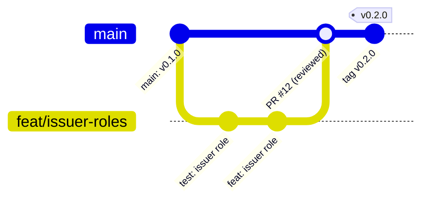
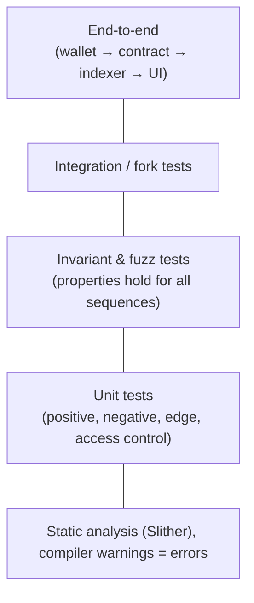

# Engineering Practices Handbook

A blockchain tutorial project and a professional blockchain system can use the
same code. What separates them is the **process** used to build, test, review
and operate that code. Every week of the course applies one or more of these
practices.

## 1. Version control

- Use one branch per feature or fix: `feat/...`, `fix/...`, `docs/...`, `test/...`.
- Follow [Conventional Commits](https://www.conventionalcommits.org/):
  `feat(contracts): add revocation with reason code`.
- Protect `main`: merge through a PR, require green CI, and require a review.
- Tag releases (`v1.2.0`) and store deployment manifests next to the tags.
- **Never** commit keys, mnemonics or API tokens. Use `.env` and commit only
  `.env.example`.

## 2. Architecture and maintainability

- Separate the layers: `contracts/`, `frontend/`, `services/`, `infra/`.
- Give each contract, module and function a single responsibility.
- Depend on interfaces (`ICertificateRegistry`), not on concrete contracts.
- Record significant decisions as ADRs ([template](templates/ADR_TEMPLATE.md)).
- Write the simple version first. Abstract on the third repetition, not the first.

## 3. Security by design

| Question to ask for every function | Example answer |
|---|---|
| Who may call it? | Only `ISSUER_ROLE` |
| What inputs are invalid? | Zero hash, already-issued ID |
| What external calls happen, and in what order? | None. Or checks → effects → interactions |
| What event proves it happened? | `CertificateIssued(id, issuer, hash)` |
| What happens if it's paused? | It reverts with `EnforcedPause()` |

- Treat user input, external contracts, oracles and off-chain data as **untrusted**.
- Keep privileged functions to a minimum and document every trust assumption.
- Put critical admin roles behind a multisig, plus a timelock where that makes sense.

## 4. Testing and verification

- Write the test before or alongside the code.
- For every rule, test that the right caller **succeeds** and that the wrong
  caller or wrong input **fails with the expected error**.
- Use fuzzing and invariants for state machines.
- Get an independent review before the system handles real value.

## 5. CI/CD and release management

- Automate format check, build, test, coverage and Slither on every PR.
- Pin `solc`, Foundry, Node and Python dependency versions.
- Keep separate configs for local, testnet and production.
- Verify deployed bytecode on the explorer and keep a deployment manifest.

## 6. Observability and operations

- Monitor tx failure rate, RPC availability, indexer lag and gas spend.
- Make event processing **idempotent**, keyed by `(txHash, logIndex)`.
- Wait for N confirmations or finality, and handle reorgs explicitly.
- Retry transient failures with exponential backoff and jitter.
- Keep a runbook for incidents (pause, communicate, investigate, recover).

## Definition of Done (applies to every week)

- [ ] Code compiles with **zero warnings**
- [ ] Tests for success, failure, and edge cases pass
- [ ] README explains *what*, *why* and *how to run*
- [ ] No secrets or personal data committed
- [ ] Commit messages describe the change
- [ ] Journal entry written
