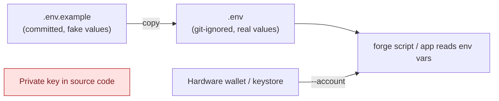

# Environment Setup

Install each tool **when the course first needs it**. You don't need
everything on day one.

## Week 1+: Git and an editor

```bash
git --version          # any recent version
git config --global user.name  "Your Name"
git config --global user.email "you@example.com"
```

Recommended editor: VS Code with the *Solidity* (Nomic Foundation), *Python*,
*ESLint* and *Markdown Preview Mermaid Support* extensions. The diagrams in
this course are written in [Mermaid](https://mermaid.js.org/), which GitHub
renders automatically.

## Week 3+: Python

```bash
python --version       # 3.11 or newer
python -m venv .venv
# macOS/Linux: source .venv/bin/activate
# Windows:     .venv\Scripts\activate
pip install -r requirements-dev.txt   # in each Python project folder
```

## Week 6+: Foundry

**macOS / Linux / WSL / Git Bash**

```bash
curl -L https://foundry.paradigm.xyz | bash
foundryup
```

**Windows (native)**: download `foundry_stable_win32_amd64.zip` from
<https://github.com/foundry-rs/foundry/releases>, extract `forge.exe`,
`cast.exe`, `anvil.exe` and `chisel.exe` into `%USERPROFILE%\.foundry\bin`, and
add that folder to your `PATH`.

Check it worked:

```bash
forge --version
anvil --version
```

This course was tested with **forge 1.5.1** and **solc 0.8.24**.

## Week 10+: Node.js

```bash
node --version   # 20 LTS or newer
npm --version
```

## Week 14+: Slither (static analysis)

```bash
pip install slither-analyzer==0.10.4
slither --version
```

## Week 15+: Docker (optional, for reproducible environments)

Install Docker Desktop, then run `docker --version`.

## Secrets hygiene (read this before Week 6)



- Use Anvil's **publicly known** test keys only on your local chain.
- For testnets, use a **fresh wallet that never holds real funds**, and
  import it with `cast wallet import` (encrypted keystore) instead of
  pasting the raw key into `.env`.
- If you ever commit a secret, treat it as compromised. Rotate it right
  away. Rewriting git history does not undo the leak.
