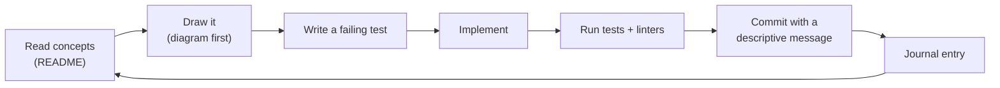

# 18-Week Syllabus

Plan on **8–12 hours per week**. If you want more time for implementation and
security exercises, stretch the course to 24 weeks.

```mermaid
gantt
    title Course timeline (weeks)
    dateFormat  X
    axisFormat  %s
    section Phase 1
    Foundations & architecture      :p1, 1, 4
    section Phase 2
    Cryptography & distributed sys  :p2, 4, 6
    section Phase 3
    Smart contract engineering      :p3, 6, 10
    section Phase 4
    dApp development                :p4, 10, 13
    section Phase 5
    Engineering & security          :p5, 13, 16
    section Phase 6
    Production & capstone           :p6, 16, 19
```

| Week | Topic | Folder | Assignment |
|-----:|-------|--------|------------|
| 1 | Blockchain concepts, ledgers, nodes, validators | [week-01](../phase-1-foundations/week-01-blockchain-concepts/) | Diagram a transaction's journey |
| 2 | Chain types, BTC vs ETH, L1 vs L2, consensus, finality | [week-02](../phase-1-foundations/week-02-chain-types-consensus/) | Compare chains for a business use case |
| 3 | Wallets, keys, tx lifecycle, gas, RPC, state | [week-03](../phase-1-foundations/week-03-blockchain-simulator/) | Python blockchain simulator |
| 4 | Hashing, signatures, Merkle trees | [week-04](../phase-2-cryptography/week-04-verifiable-ledger/) | Tamper-evident signed ledger |
| 5 | P2P, PoW/PoS, BFT, forks, reorgs, finality | [week-05](../phase-2-cryptography/week-05-consensus-forks/) | Fork and reorg simulator |
| 6 | Solidity basics | [week-06](../phase-3-smart-contracts/week-06-solidity-basics/) | On-chain registry |
| 7 | Modifiers, inheritance, interfaces, errors, libraries | [week-07](../phase-3-smart-contracts/week-07-modular-contracts/) | Modular registry refactor |
| 8 | EVM, gas, payable, token standards | [week-08](../phase-3-smart-contracts/week-08-evm-gas-tokens/) | Token + asset registry |
| 9 | Access control, pausing, upgradeability | [week-09](../phase-3-smart-contracts/week-09-access-control/) | Role-controlled pausable contract |
| 10 | TypeScript, React, wallets, viem | [week-10](../phase-4-dapp/week-10-frontend-wallet/) | Connect frontend to contract |
| 11 | Reads, writes, confirmations, events, errors | [week-11](../phase-4-dapp/week-11-transactions-events/) | Asset register/retrieve UI |
| 12 | Backend, DB, event indexing, off-chain storage | [week-12](../phase-4-dapp/week-12-backend-indexer/) | Search + history + documents |
| 13 | Clean architecture, refactoring, code review | [week-13](../phase-5-engineering-security/week-13-clean-architecture/) | Modular capstone refactor |
| 14 | Testing pyramid, fuzz/invariant, Slither, threat modeling | [week-14](../phase-5-engineering-security/week-14-testing-security/) | Attack-sequence tests |
| 15 | CI/CD, pinning, secrets, releases | [week-15](../phase-5-engineering-security/week-15-cicd/) | GitHub Actions pipeline |
| 16 | Local/testnet deployment, verification | [week-16](../phase-6-production/week-16-deployment/) | Deploy to Anvil + testnet |
| 17 | Monitoring, retries, idempotency, reorgs, incidents | [week-17](../phase-6-production/week-17-operations/) | Monitor + recover from failures |
| 18 | Docs, security review, gas report, demo | [week-18](../phase-6-production/week-18-final-delivery/) | Final dApp, report, demo |

## Weekly rhythm

## Assessment per phase

| Phase | Evidence of mastery |
|-------|---------------------|
| 1 | You can explain, without notes, how a signed transaction becomes final state. The simulator's tests pass. |
| 2 | Your ledger detects any single-byte tamper, and you can explain a reorg with a diagram. |
| 3 | `forge test` passes with zero compiler warnings, and every public function has NatSpec. |
| 4 | A user can connect a wallet, send a transaction, see it confirmed, and search its history. |
| 5 | CI is green, Slither findings are triaged, and a threat model exists. |
| 6 | A reviewer can clone, build, test and deploy the project using only the README. |
