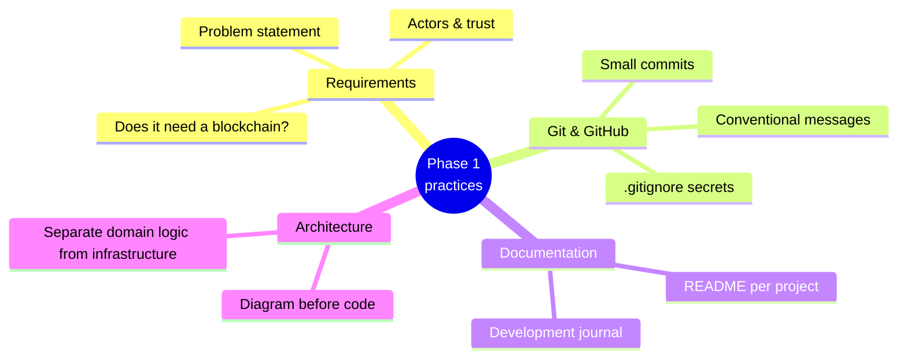

# Phase 1 — Blockchain Fundamentals & Architecture (Weeks 1–3)

**Deliverables:** an architecture diagram of a transaction's lifecycle, and a
tested Python blockchain simulator.

| Week | Lesson | You will produce |
|------|--------|------------------|
| 1 | [Blockchain concepts](week-01-blockchain-concepts/) | A diagram + written explanation of a transaction's journey |
| 2 | [Chain types, consensus & finality](week-02-chain-types-consensus/) | A comparison report for a business use case |
| 3 | [Wallets, gas, state → simulator](week-03-blockchain-simulator/) | `minichain`, a Python simulator with tests |

## Engineering practices introduced in this phase

1. **Requirements first.** Use [REQUIREMENTS_TEMPLATE.md](../docs/templates/REQUIREMENTS_TEMPLATE.md).
2. **Git from line one.** Commit after every working step.
3. **README + journal.** Use [JOURNAL_TEMPLATE.md](../docs/templates/JOURNAL_TEMPLATE.md).
4. **Separate business logic from infrastructure.** You'll see this in Week 3:
   `minichain/domain/` knows nothing about the CLI or storage.
5. **Diagram before you implement.** Every week starts with a picture.
