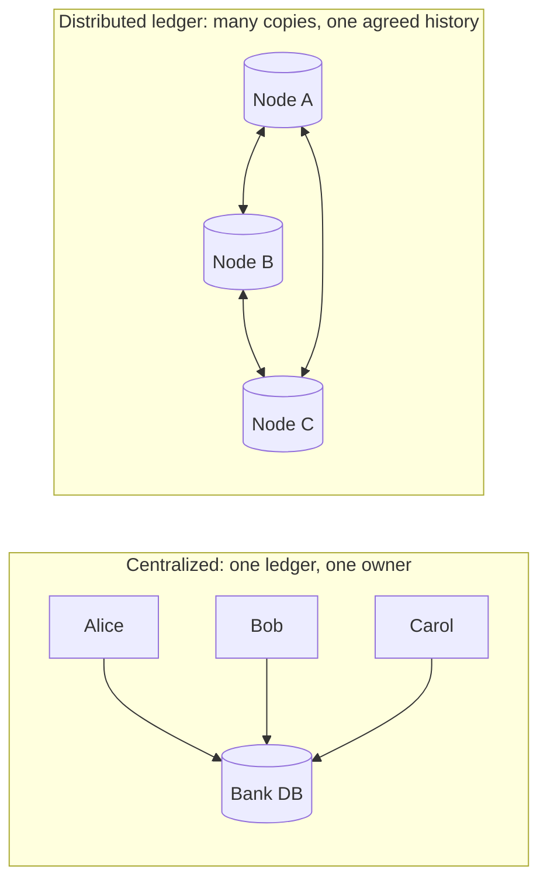
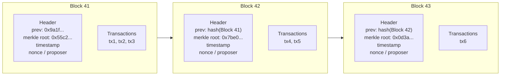
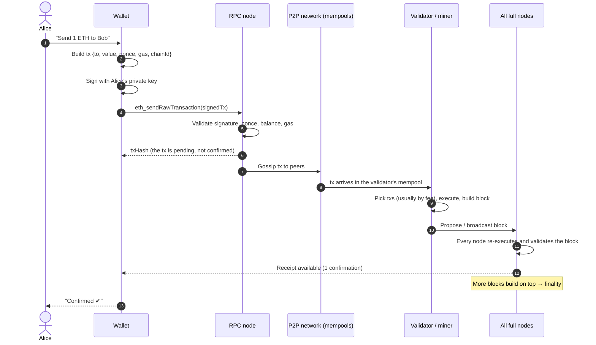
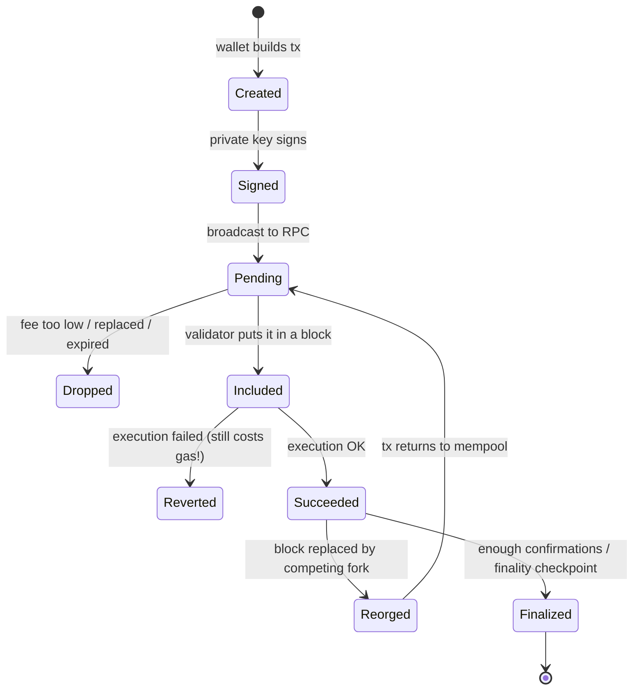

# Week 1 — Blockchain Concepts

> **Goal:** explain, in your own words and with a diagram, how a transaction
> moves from a user's wallet into a block that everyone agrees on.

**Time budget:** 8–12 h · **Prerequisites:** none

---

## 1.1 The problem a blockchain solves

Picture three banks that keep their own ledgers of who owes whom. Each night
they reconcile. When the numbers disagree, people spend days working out
whose copy is right.

| | Centralized database | Distributed ledger / blockchain |
|---|---|---|
| Who can write? | The operator | Anyone following the protocol (public) or approved members (permissioned) |
| Who do you trust? | The operator | The protocol + an honest majority of validators |
| Single point of failure? | Yes | No (many replicas) |
| Can history be quietly rewritten? | Yes, by the admin | Not without detection, and economically very hard |
| Throughput | Very high | Lower (agreement costs time) |
| Privacy | Easy | Hard (public by default) |

**Key insight:** a blockchain **trades efficiency for not having to trust a
single party**. It's only worth that cost when the parties writing shared
state don't fully trust each other *and* no acceptable intermediary exists.

## 1.2 Vocabulary you must own

| Term | One-sentence definition |
|------|------------------------|
| **Ledger** | An append-only record of transactions. |
| **Transaction (tx)** | A signed instruction from an account to change state ("send 5 to Bob", "call `issue()`"). |
| **Block** | A batch of transactions plus a header that contains the **hash of the previous block**. |
| **Chain** | Blocks linked by those previous-hash pointers. Change any block and every later link breaks. |
| **Node** | A computer running the protocol software that stores the chain and checks the rules. |
| **Full node** | Checks every block and transaction itself. |
| **Light client** | Checks headers and proofs, and trusts full nodes for the rest. |
| **Miner (PoW)** | A node that competes to find a hash below a target to earn the right to add a block. |
| **Validator (PoS)** | A node that locks up (stakes) coins to earn the right to propose and attest to blocks. |
| **Mempool** | Each node's waiting room of valid transactions that aren't in a block yet. |
| **Consensus** | The rules by which nodes agree on *which* block comes next. |
| **State** | The current snapshot (balances, contract storage) you get by replaying every transaction. |

## 1.3 Anatomy of a block

The **Merkle root** is a single hash that commits to every transaction in the
block (Week 4 covers it in depth). Because the next block's header contains
this block's hash, changing tx2 changes Block 41's Merkle root, which changes
its header hash, which breaks Block 42's `prev` pointer, and so on to the tip.

## 1.4 The journey of a transaction (the Week 1 assignment diagram)

### The same journey as a state machine

> ⚠️ **Common misconceptions**
> - *"I got a txHash, so it worked."* No. A txHash only means the node
>   **accepted** the transaction. It can still be dropped, revert, or be
>   reorged out.
> - *"Reverted transactions are free."* No. On Ethereum you pay for the gas
>   used up to the point of revert.
> - *"Blockchains store files."* Mostly not. They store small, essential state
>   and hashes. Big data lives off-chain.

## 1.5 Miners vs validators

| | Proof of Work (Bitcoin) | Proof of Stake (Ethereum since 2022) |
|---|---|---|
| Right to propose comes from | Computing work (hashes) | Locked stake + random selection |
| Cost of attacking | Electricity + hardware | Your stake gets slashed |
| Block time | ~10 min | 12 s slots |
| Finality | Probabilistic (wait ~6 blocks) | Economic finality after ~2 epochs (~13 min) |

Week 5 has you simulate both.

## 1.6 Hands-on: watch a real chain (30 min, read-only)

1. Open <https://etherscan.io> (Ethereum) and <https://mempool.space> (Bitcoin).
2. Click the latest block. Find: block number, parent hash, number of txs,
   gas used, fee recipient or miner.
3. Click any transaction. Find: from, to, value, nonce, gas price, status.
4. On mempool.space, watch unconfirmed transactions waiting in the mempool.

Write down which field links a block to its parent.

## 1.7 Assignment

Create `my-work/week-01/transaction-journey.md` containing:

1. **A diagram** (Mermaid, draw.io, or a photo of paper) showing a
   transaction's path from wallet to finality. Label every actor.
2. **A 300-word explanation** that answers:
   - What does the signature prove, and what doesn't it prove?
   - Why does a node check the nonce?
   - What is the difference between *included*, *confirmed* and *finalized*?
   - Why can't a single validator change an old transaction?
3. **Centralized vs decentralized**: describe one system you use daily that
   should stay centralized, and explain why.

A worked solution is in [SOLUTION.md](SOLUTION.md). Try it yourself first.

## ✅ Week 1 checklist

- [ ] I can define all the terms in §1.2 without looking.
- [ ] I can draw the transaction sequence diagram from memory.
- [ ] I explored a real block and transaction on an explorer.
- [ ] My assignment is committed: `git commit -m "docs(week-01): transaction journey diagram"`
- [ ] Journal entry written.

**Next:** [Week 2 — Chain types, consensus & finality](../week-02-chain-types-consensus/)
