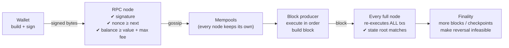

# Week 1 — Worked Solution

## Diagram

The answer diagram is the sequence diagram and state machine in
[README §1.4](README.md#14-the-journey-of-a-transaction-the-week-1-assignment-diagram).
A strong student diagram also shows **where each check happens**:

## Explanation (model answer, about 300 words)

**What the signature proves.** The signature proves that whoever holds the
private key for the sending address authorized *exactly these bytes*: the
recipient, value, nonce, gas fields and chain ID. Nobody can change the amount
or recipient without making the signature invalid. It does **not** prove the
signer is a particular human, that the transaction is a good idea, or that it
will succeed when executed.

**Why nodes check the nonce.** The nonce is a per-account counter. Each nonce
can be used only once, and they must be used in order. That stops **replay**,
where someone rebroadcasts a signed payment to have it executed twice. It
also gives an account's transactions a definite order. Together with the
chain ID (EIP-155), it stops a transaction signed for one chain from being
replayed on another.

**Included vs confirmed vs finalized.**
*Included* means the transaction is in a block a validator produced.
*Confirmed* (with N confirmations) means N−1 more blocks have been built on
top, so a reorg is less and less likely. *Finalized* means the consensus
protocol considers the block irreversible: Ethereum PoS reaches this through
finality checkpoints, while Bitcoin only becomes "practically final" after
about 6 blocks.

**Why one validator can't rewrite history.** Every block header contains the
previous block's hash. Changing an old transaction changes that block's hash
and breaks every later link. Honest nodes re-execute and validate each block,
so they reject the altered chain. To get it accepted you would need to out-build
the honest network (PoW: a majority of hash power) or get finalized checkpoints
reverted (PoS: at least 1/3 of stake slashed). Both are extremely expensive.

## A system that should stay centralized

**A hospital's patient-records system.** One organization is accountable, the
data is highly sensitive (and regulated, e.g. under GDPR or HIPAA), records
sometimes have to be *corrected or deleted*, and access control has to be
fine-grained. A public blockchain's transparency and immutability work against
every one of those requirements. A well-audited centralized database with
append-only audit logs is the right tool.
