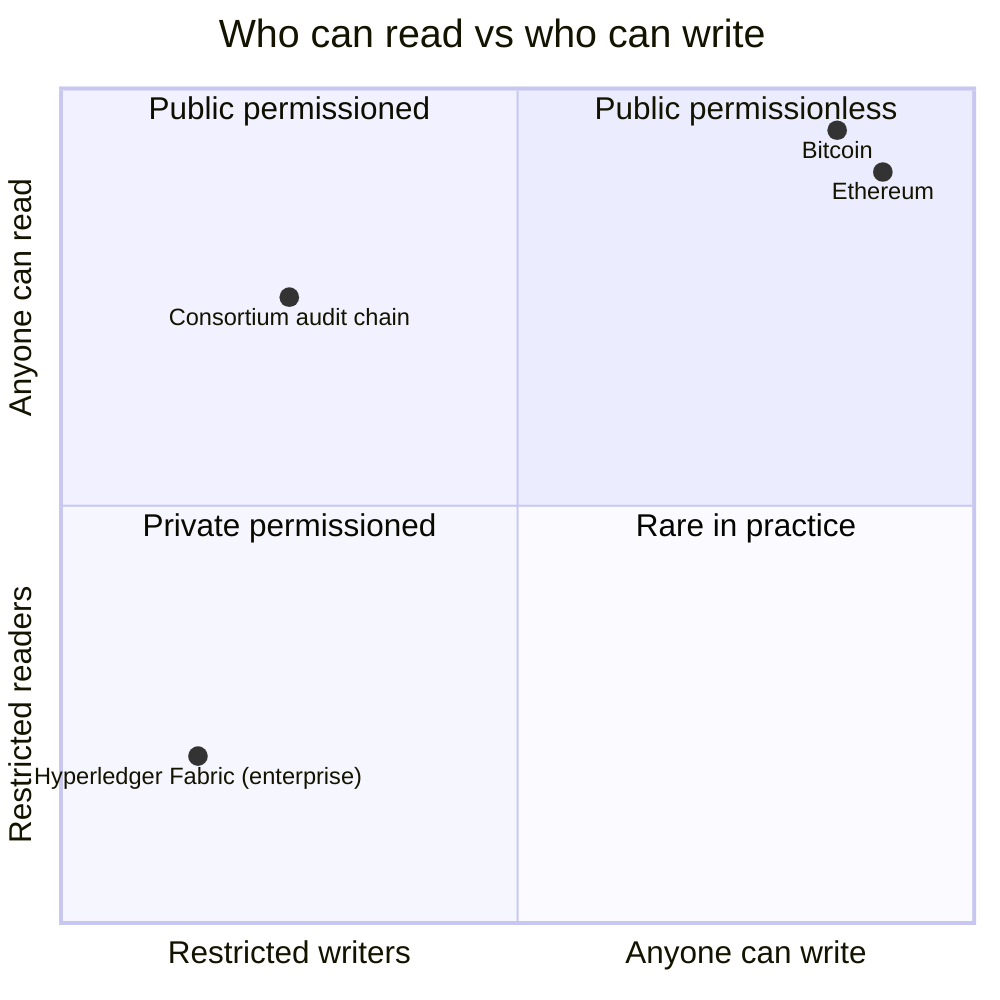
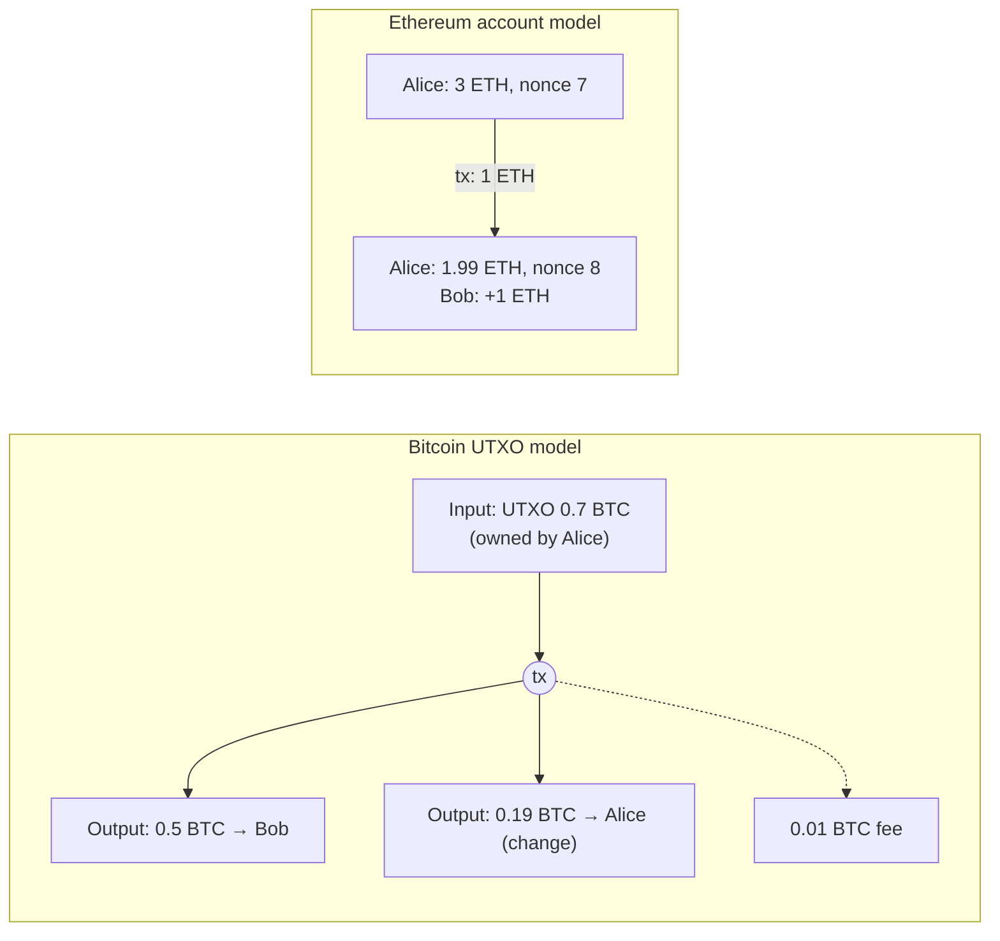
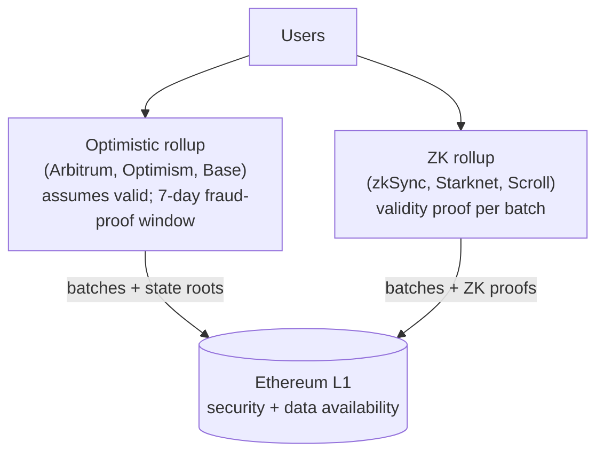
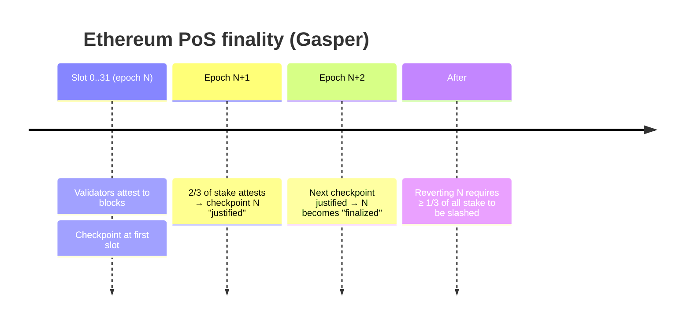
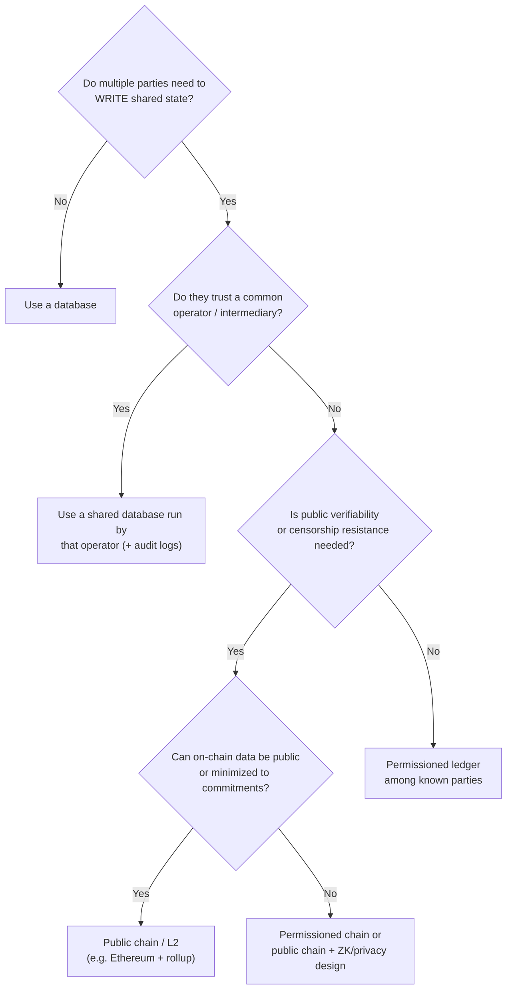

# Week 2 — Chain Types, Consensus & Finality

> **Goal:** pick the right kind of ledger for a business problem and defend
> the choice in writing, including the option of *no blockchain at all*.

---

## 2.1 Public, private and permissioned

| Type | Who validates | Examples | Good for | Watch out for |
|------|---------------|----------|----------|---------------|
| **Public permissionless** | Anyone with stake or hash power | Ethereum, Bitcoin | Open verification, censorship resistance, composability | Public data, fees, volatility |
| **Public permissioned** | Known validators; anyone can read | Some consortium chains | Public auditability with a known operator set | Validator collusion |
| **Private / permissioned** | A consortium of known orgs | Hyperledger Fabric, Quorum | Multi-company workflows with privacy | Often a shared database would do |

## 2.2 Bitcoin vs Ethereum

| | Bitcoin | Ethereum |
|---|---|---|
| Purpose | Peer-to-peer electronic cash, store of value | Programmable world computer |
| State model | **UTXO**: unspent outputs, like banknotes | **Accounts**: balances + contract storage |
| Programmability | Limited script | Turing-complete EVM (Solidity, Vyper) |
| Consensus | Proof of Work | Proof of Stake (since Sept 2022) |
| Block time | ~10 min | 12 s |
| Finality | Probabilistic (~6 blocks ≈ 1 h) | Finalized after ~2 epochs (≈ 12.8 min) |
| Fees | sat/vByte (by tx size) | Gas (by computation) × (base fee + priority tip) |

## 2.3 Layer 1 vs Layer 2

**Layer 1** is the base chain that provides security and data availability.
**Layer 2** systems execute transactions off L1 and post compressed data or
proofs back to it.

| | Optimistic rollup | ZK rollup |
|---|---|---|
| Validity | Assumed, challengeable with fraud proofs | Proven with zero-knowledge proofs |
| Withdrawal to L1 | ~7 days (challenge window) | Minutes to hours (once the proof is verified) |
| EVM compatibility | Very high | High and improving |

## 2.4 Consensus and finality

**Consensus** answers "which block is next?" **Finality** answers "when can
it no longer change?"

| Finality type | Mechanism | Example | Practical rule |
|---|---|---|---|
| Probabilistic | Longest/heaviest chain; each extra block makes reversal exponentially less likely | Bitcoin | Wait 6 confirmations for value |
| Economic | Validators sign checkpoints, and equivocation is slashed | Ethereum PoS | Use `finalized` block tag for irreversible actions |
| Instant (BFT) | ≥ 2/3 of known validators sign each block | Tendermint/CometBFT, many permissioned chains | Final once committed |

## 2.5 Decision tree: do you need a blockchain?

## 2.6 Assignment: compare chains for a business use case

**Use case:** *a university consortium wants employers to verify
graduates' certificates without phoning the registrar.* (This is the
capstone.)

Write `my-work/week-02/chain-comparison.md` with:

1. The requirements: actors, trust, privacy, cost and volume (use the
   [requirements template](../../docs/templates/REQUIREMENTS_TEMPLATE.md)).
2. A comparison table: **Ethereum L1**, **an Ethereum L2**, **Bitcoin**,
   **a permissioned chain (Fabric)**, and **a plain signed-PDF + central
   database**.
3. A recommendation written as an ADR ([template](../../docs/templates/ADR_TEMPLATE.md)).

A worked solution is in [SOLUTION.md](SOLUTION.md).

## ✅ Week 2 checklist

- [ ] I can explain UTXO vs account model with a diagram.
- [ ] I can explain why "6 confirmations" exists and what `finalized` means on Ethereum.
- [ ] I can say when *not* to use a blockchain.
- [ ] My comparison + ADR are committed.

**Next:** [Week 3 — Wallets, gas & the blockchain simulator](../week-03-blockchain-simulator/)
