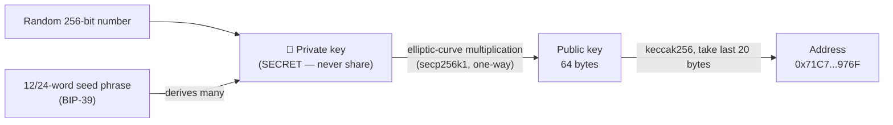
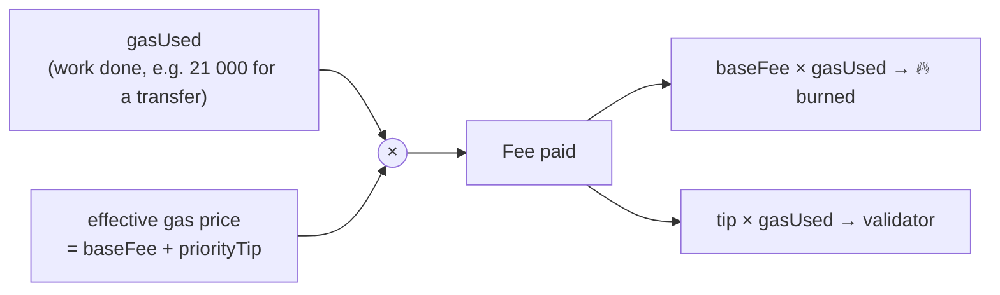
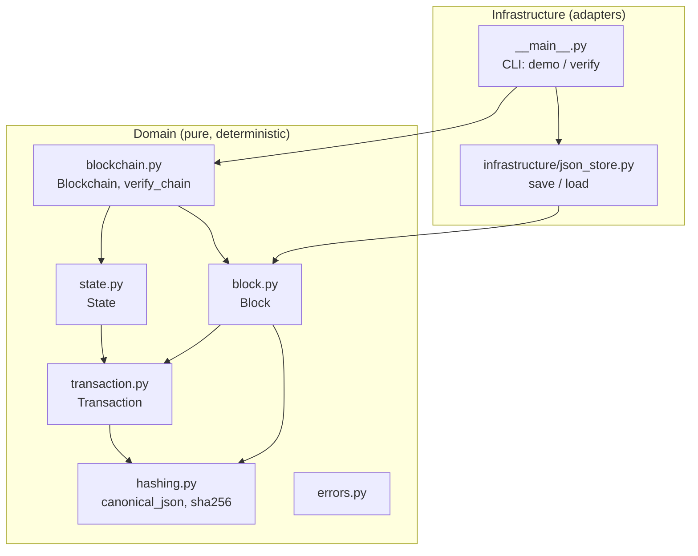
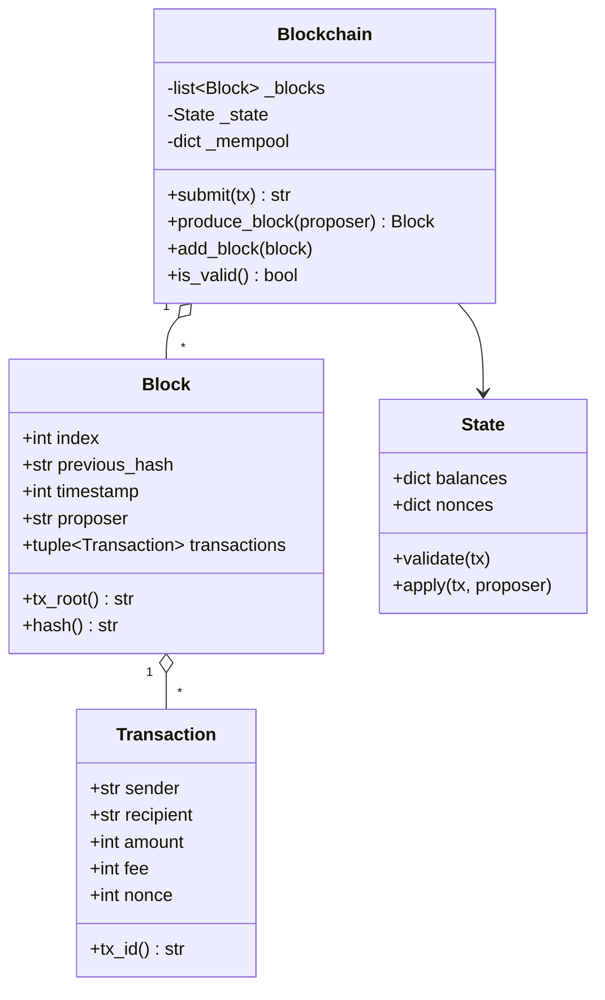
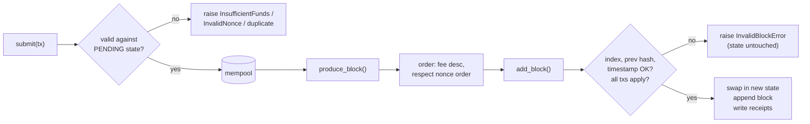

# Week 3 — Wallets, Gas, State → Build a Blockchain Simulator

> **Goal:** understand accounts, nonces, fees and state by **building** them.
> You'll write `minichain`, a small, fully tested blockchain simulator in Python.

---

## Part A — Concepts

### 3.1 Keys, addresses, wallets



- **A wallet does not hold coins.** It holds *keys*. Coins and tokens live in
  the chain's state, recorded against an address.
- Anyone with the private key or seed phrase controls the account,
  permanently. There is no "forgot password".
- **EOA** (externally owned account): controlled by a key. **Contract
  account**: controlled by code (Week 6).

### 3.2 Anatomy of an Ethereum transaction

| Field | Meaning | In `minichain` |
|-------|---------|----------------|
| `from` | Recovered from the signature, not sent explicitly | `sender` |
| `to` | Recipient or contract | `recipient` |
| `value` | Wei to transfer (1 ETH = 10¹⁸ wei) | `amount` |
| `nonce` | Sender's tx counter | `nonce` |
| `gasLimit` | Max computation units you'll pay for | (simplified into `fee`) |
| `maxFeePerGas`, `maxPriorityFeePerGas` | EIP-1559 fee caps | (simplified into `fee`) |
| `data` | Calldata, used for contract calls | — (Week 6) |
| `chainId` | Prevents cross-chain replay | — |
| `v, r, s` | ECDSA signature | — (Week 4!) |

### 3.3 Gas, in one picture



**Gas prevents infinite loops and spam.** Every operation costs gas, and when
gas runs out the transaction **reverts but still pays**.

Worked example: a 21,000-gas transfer at base fee 20 gwei + tip 2 gwei costs
`21 000 × 22 gwei = 462 000 gwei = 0.000462 ETH`.

### 3.4 State and RPC

**State** is the result of replaying every transaction from genesis. Nodes
store the current state. Clients *ask* nodes about it over **JSON-RPC**:

```bash
# Ask a node for a balance (try this against Anvil in Week 6)
curl -s -X POST localhost:8545 -H 'content-type: application/json' \
  -d '{"jsonrpc":"2.0","id":1,"method":"eth_getBalance","params":["0x...","latest"]}'
```

| RPC method | Question it answers |
|------------|---------------------|
| `eth_getBalance` | How much does this address hold? |
| `eth_getTransactionCount` | What's this address's next nonce? |
| `eth_sendRawTransaction` | Please broadcast this signed tx |
| `eth_getTransactionReceipt` | Was it included? Did it succeed? |
| `eth_call` | Simulate a call without sending a tx (free, read-only) |
| `eth_getLogs` | Give me the events matching this filter |

A **block explorer** (Etherscan) is a website built on top of these RPCs plus
an indexer database.

---

## Part B — Design before code

### 3.5 Requirements

| ID | Requirement |
|----|-------------|
| FR-1 | Create a chain with initial (genesis) balances |
| FR-2 | Submit transfers to a mempool. Reject overspend, bad nonce, malformed or duplicate txs |
| FR-3 | Produce blocks that pick the highest fees first while respecting nonce order |
| FR-4 | Pay fees to the block proposer |
| FR-5 | Verify the full chain from genesis, and detect tampering |
| FR-6 | Save/load the chain to JSON and verify a file from the CLI |
| NFR-1 | Deterministic: same inputs give the same hashes, so tests can be reproduced |
| NFR-2 | Domain logic has **no** I/O dependencies |

### 3.6 Architecture



Dependencies point **inward**: infrastructure depends on the domain, and
never the other way round. This is the "separate business logic from
infrastructure" practice. In Week 13 you'll recognize it as *clean
architecture*.

### 3.7 Class diagram



---

## Part C — Step-by-step build

Run everything from this folder:

```bash
python -m venv .venv && source .venv/bin/activate   # Windows: .venv\Scripts\activate
pip install -r requirements-dev.txt
```

### Step 1 — Canonical hashing ([hashing.py](minichain/domain/hashing.py))

```python
def canonical_json(data):
    return json.dumps(data, sort_keys=True, separators=(",", ":")).encode()
```

**Why:** every node must produce **byte-identical** serializations, or their
hashes won't match. Sorted keys and no whitespace guarantee that.

### Step 2 — An always-valid Transaction ([transaction.py](minichain/domain/transaction.py))

Validation happens in `__post_init__`, so **an invalid `Transaction` can
never exist**. Notice the details:

- Amounts are `int`, never `float`. `0.1 + 0.2 != 0.3` in floating point.
  Ethereum uses integer wei for exactly this reason.
- `isinstance(True, int)` is `True` in Python, so `bool` is rejected
  explicitly. Handle invalid input explicitly.
- `tx_id` is a hash of the contents (content addressing).

### Step 3 — State with checks-before-effects ([state.py](minichain/domain/state.py))

```python
def apply(self, tx, proposer):
    self.validate(tx)              # 1. CHECK: nonce and balance
    self.balances[tx.sender] -= ...  # 2. EFFECTS: mutate only after all checks pass
```

This is the Python ancestor of Solidity's **checks-effects-interactions**
pattern (Week 9 and Week 14).

### Step 4 — Blocks linked by hash ([block.py](minichain/domain/block.py))

The header contains `previous_hash` and `tx_root`. The block hash covers the
header, so it covers every transaction indirectly.

### Step 5 — The chain ([blockchain.py](minichain/domain/blockchain.py))



Three subtleties worth studying:

1. **Pending state.** `submit` checks against *confirmed state + the mempool*.
   That's why, in the demo, the rejection message says Carol's balance is
   **15** even though her confirmed balance is 0: it counts the pending
   transfers from Alice and Bob. She could spend up to 15 in the same block.
   Real nodes behave the same way.
2. **Atomic blocks.** `add_block` applies transactions to a **copy** of the
   state and swaps it in only if all of them succeed.
3. **Injected clock.** `Blockchain(..., clock=...)` instead of calling
   `time.time()` keeps hashes deterministic in tests.

### Step 6 — Infrastructure ([json_store.py](minichain/infrastructure/json_store.py), [`__main__.py`](minichain/__main__.py))

`load_blocks` **recomputes** every hash and never trusts the stored one.
Rule: never trust data you didn't compute or verify yourself.

### Step 7 — Run it

```bash
python -m minichain demo --out chain.json
python -m minichain verify chain.json          # → VALID
# Now edit an amount inside chain.json by hand and run verify again → TAMPERED
```

Expected demo output:

```text
Genesis: {'alice': 100, 'bob': 20}
Mempool: 3 pending txs
Rejected (expected): carol: balance 15 < cost 500

Block #1  hash=8e56b49a...  prev=95c09d29...
     bob -> carol  amount=5   fee=3 nonce=0
   alice -> bob    amount=30  fee=2 nonce=0
   alice -> carol  amount=10  fee=1 nonce=1
  ...
Total supply conserved: True
Chain valid: True
```

### Step 8 — Test it

```bash
python -m pytest --cov=minichain --cov-report=term-missing
```

| Test file | What it proves |
|-----------|----------------|
| [test_transaction.py](tests/test_transaction.py) | Deterministic IDs; every malformed input is rejected (parametrized) |
| [test_blockchain.py](tests/test_blockchain.py) | Happy path, fee ordering, nonce rules, overspend, replay, bad blocks, **tamper detection**, **invariants** |
| [test_cli_and_storage.py](tests/test_cli_and_storage.py) | Save → verify round-trip; an edited file is detected |

**Invariants** are properties that must hold *no matter what happened*:

- **Supply conservation:** `sum(balances) == sum(genesis)`. Fees move value,
  they don't create it.
- **Nonce accounting:** `sum(nonces) == number of included txs`.

You'll write invariant tests for Solidity in Week 14. They catch bugs that
example-based tests miss.

---

## Part D — Known weaknesses (fixed in Phase 2)

| Weakness | Consequence | Fixed in |
|----------|-------------|----------|
| No signatures | Anyone can submit a tx "from" Alice | Week 4 (ECDSA) |
| `tx_root` is a flat hash | Proving one tx is included needs the entire block | Week 4 (Merkle tree) |
| One node, no consensus | No forks, no adversaries | Week 5 (PoW/PoS, forks, reorgs) |

## Assignment

1. Add a `block_reward` constructor parameter that mints new coins to each
   proposer. Then **update the supply invariant**. What should it be now?
2. Add a `max_block_fee`-style limit (a toy "gas limit") so a block can't
   include more than N total fee units.
3. Write tests first for both.

## ✅ Week 3 checklist

- [ ] I can explain private key → public key → address.
- [ ] I can compute a transaction fee from gas used and gas price.
- [ ] `pytest` passes, coverage > 90%.
- [ ] I can explain why `submit` validates against pending state.
- [ ] I can explain why the domain package has no file I/O.

**Next:** [Phase 2 — Week 4: Cryptography & the verifiable ledger](../../phase-2-cryptography/week-04-verifiable-ledger/)
