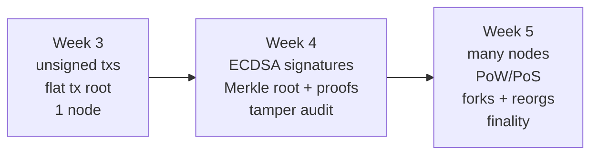

# Phase 2 — Cryptography & Distributed Systems (Weeks 4–5)

**Deliverable:** a verifiable transaction ledger, plus a simulator that
demonstrates forks, reorgs and finality.

| Week | Lesson | You will produce |
|------|--------|------------------|
| 4 | [Cryptography → verifiable ledger](week-04-verifiable-ledger/) | Signed txs, Merkle proofs, tamper audit |
| 5 | [Consensus, forks & reorgs](week-05-consensus-forks/) | PoW / PoS / BFT simulator with fork choice |

## Engineering practices introduced

- Deterministic, reproducible tests (known-answer vectors, seeded randomness).
- Invariants and preconditions stated in code and tested.
- Explicit handling of invalid input.
- Type hints, meaningful names, small functions.
- **Don't invent your own cryptographic algorithms for production.**
