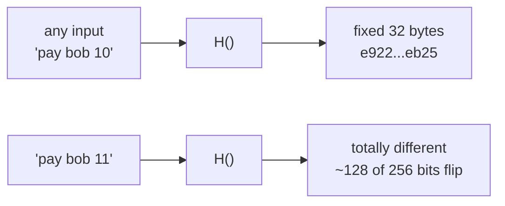
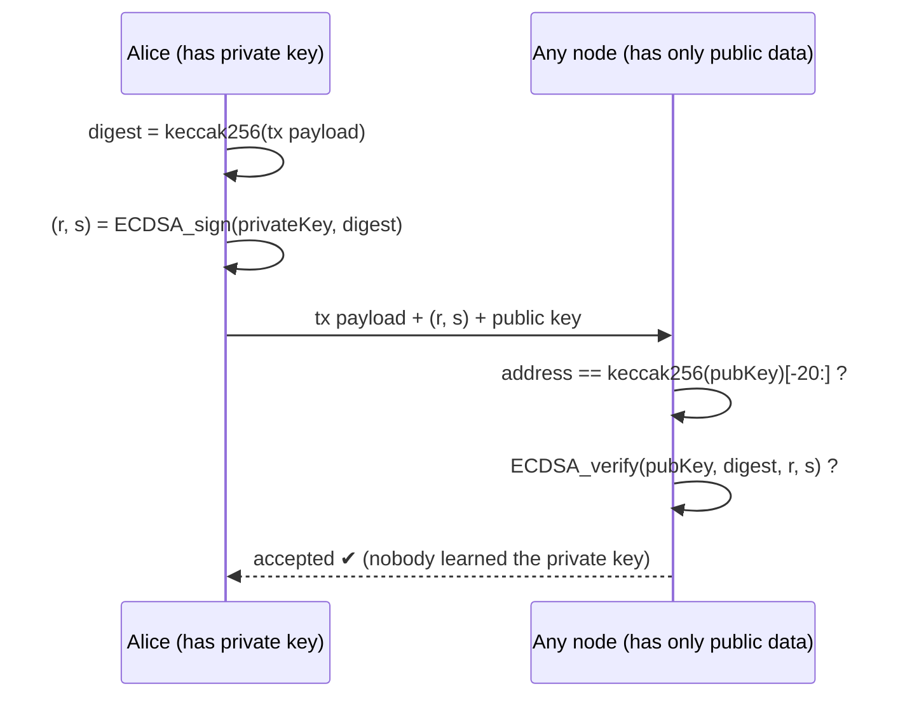
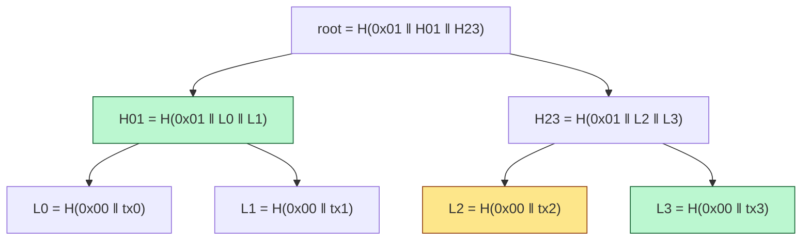
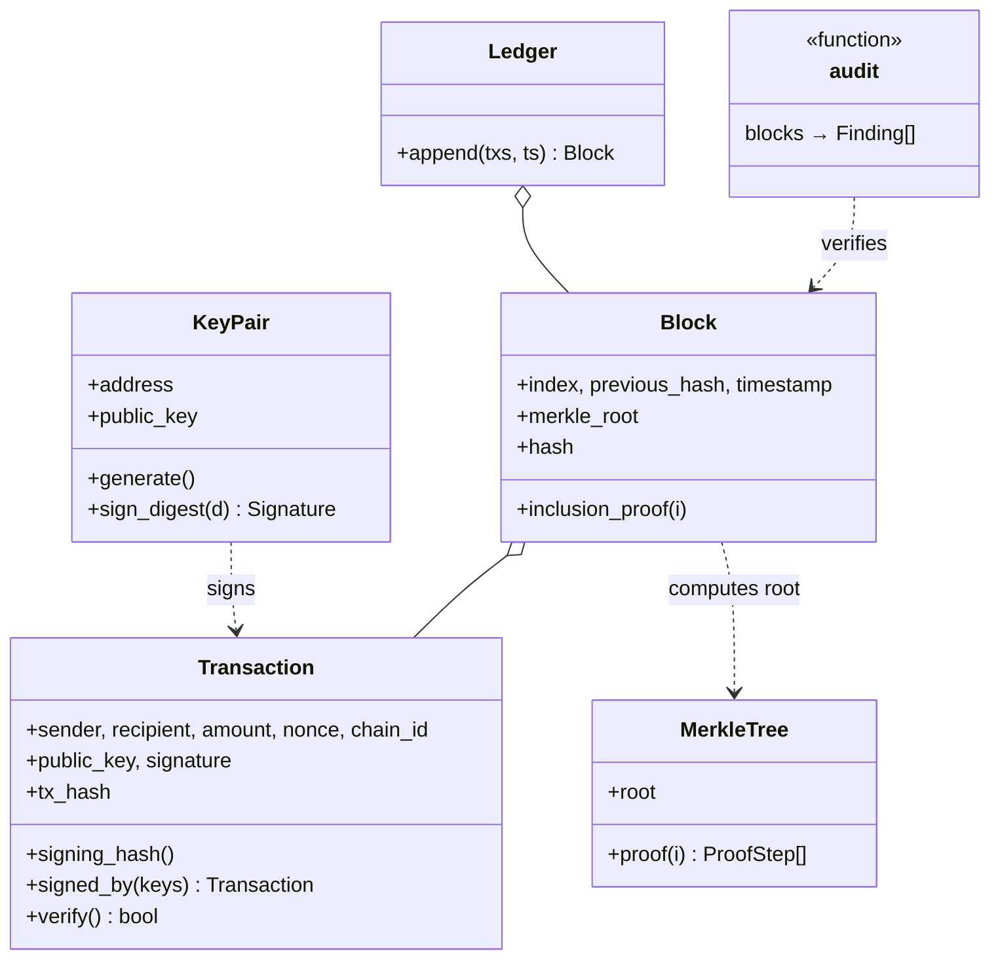
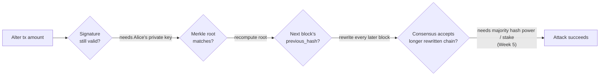

# Week 4 — Cryptography → A Verifiable Transaction Ledger

> **Goal:** fix Week 3's biggest weakness (anyone could forge a
> transaction). Add real ECDSA signatures, Ethereum-style addresses and
> Merkle trees, then build an audit that pinpoints **which** transaction
> was altered.

---

## Part A — Concepts

### 4.1 Three tools, three problems

> **Hashing ≠ encryption ≠ signing.** Learners mix these up constantly, and
> in production that mistake leads to data leaks.

| | Hash | Digital signature | Encryption |
|---|---|---|---|
| Question it answers | *Has this changed?* | *Who authorized this, and has it changed?* | *Who can read this?* |
| Keys | None | Private key signs, public key verifies | Symmetric key, or public key encrypts / private key decrypts |
| Reversible? | No (one-way) | N/A. The message stays public | Yes, with the key |
| Blockchain use | Block links, tx IDs, Merkle roots, addresses | Every transaction | **Rarely on-chain.** Off-chain files |
| Demo | [hash_sign_encrypt.py](demos/hash_sign_encrypt.py) §1 | §2 | §3 |

### 4.2 Properties of a cryptographic hash



1. **Deterministic:** same input, same output.
2. **Preimage resistance:** given `h`, you can't find `x` with `H(x)=h`.
3. **Second-preimage resistance:** given `x`, you can't find another `x'` with the same hash.
4. **Collision resistance:** you can't find any pair `x≠y` with `H(x)=H(y)`.
5. **Avalanche effect:** a 1-bit input change flips about 50% of output bits
   (see `test_avalanche_effect`).

| | SHA-256 | Keccak-256 |
|---|---|---|
| Used by | Bitcoin (blocks, txs, addresses) | Ethereum (addresses, storage slots, function selectors, events) |
| Gotcha | — | **Not** the same as NIST `SHA3-256`! `hashlib.sha3_256` gives a different result |

> ⚠️ **"Preimage resistance" doesn't make guessable data private.** If a
> student ID has 10,000 possible values, an attacker hashes all 10,000 and
> matches yours (demo §4). Fix: hash `salt ‖ data` with a random secret salt.
> This matters a lot for the capstone.

### 4.3 Public-key cryptography and ECDSA



Ethereum details we implement:

- **Address** = last 20 bytes of `keccak256(uncompressed public key without 0x04)`.
  Our code reproduces Anvil's account #0 address exactly
  (`test_address_derivation_matches_anvil`).
- **EIP-55 checksum**: mixed-case hex that catches typos.
- **Low-s signatures (EIP-2)**: `(r, s)` and `(r, n−s)` are *both* valid
  signatures. Accepting both lets attackers change a tx's hash without
  invalidating it (**malleability**). We normalize to low-s and reject high-s.
- **Chain ID in the signed payload (EIP-155)** prevents replay on other chains.
- Real Ethereum sends `(v, r, s)` and **recovers** the public key. We send
  the public key explicitly to keep things simple; the security is the same.

### 4.4 Merkle trees



To prove **tx2** (yellow) is in the block, send only the green hashes
`[L3 (right), H01 (left)]`. The verifier recomputes the root. That's
**O(log n)** data: 20 hashes for a million transactions. This is how light
clients and SPV wallets work, and it's the same idea behind the
OpenZeppelin `MerkleProof` you'll meet in Solidity.

Two classic bugs, avoided in [merkle.py](ledger/merkle.py) and covered by tests:

| Bug | Attack | Our defence |
|-----|--------|-------------|
| No leaf/node domain separation | Present an inner node's 64 bytes as a "leaf" (second preimage) | Prefix `0x00` for leaves, `0x01` for nodes |
| Duplicate last node on odd levels | `[a,b,c]` and `[a,b,c,c]` share a root (Bitcoin CVE-2012-2459) | Promote the odd node instead |

---

## Part B — Architecture



| File | Responsibility |
|------|----------------|
| [hashing.py](ledger/hashing.py) | SHA-256, Keccak-256, canonical JSON |
| [keys.py](ledger/keys.py) | secp256k1 key pairs, addresses, EIP-55, low-s ECDSA |
| [merkle.py](ledger/merkle.py) | Merkle root and proofs |
| [transaction.py](ledger/transaction.py) | Signed, always-valid transactions |
| [ledger.py](ledger/ledger.py) | Hash-linked blocks, append rules, `audit`, `prove_inclusion` |

---

## Part C — Step by step

```bash
cd phase-2-cryptography/week-04-verifiable-ledger
pip install -r requirements-dev.txt
```

**Step 1: hashes with test vectors.** Write `keccak256` and check it against
the published empty-string vector `c5d2…a470` *before* you trust it. Rule:
cryptographic code gets **known-answer tests** from an external source,
never only "it matches what my code printed yesterday".

**Step 2: keys and addresses.** Derive the address from Anvil's well-known
key #0 and assert it equals `0xf39F…2266`. If that passes, your
Keccak, public-key encoding and slicing are all correct.

**Step 3: sign and verify.** Normalize to low-s. Write the malleability test.

**Step 4: transactions.** Sign `keccak256(canonical_json(payload))`. Then
write one test per field showing that changing it breaks `verify()`
(parametrized test `test_altering_any_signed_field_breaks_signature`).

**Step 5: Merkle tree.** Write property-based tests with **Hypothesis**:
"for *any* list of leaves, every proof verifies, and any altered leaf
fails". Hypothesis generates hundreds of random cases and *shrinks* a failure
to the smallest example. That's fuzzing, which you'll use again in Foundry
in Week 14.

**Step 6: ledger + audit.** `append()` checks every precondition (signature,
chain ID, nonce order, timestamp) and is **atomic**. `audit()` returns
`Finding(block, tx, problem)` records instead of a bare `False`.

```bash
python -m pytest --cov=ledger
python -m demos.hash_sign_encrypt
python -m demos.tamper_audit
```

Demo output (abridged):

```text
--- Attack: change Alice's 20 -> 2000 in block 2
  ✘ block 2: merkle_root does not match transactions
  ✘ block 2, tx 0: signature invalid (tx altered or forged)

--- Smarter attack: also recompute block 2's Merkle root
  ✘ block 2, tx 0: signature invalid (tx altered or forged)
  ✘ block 3: previous_hash does not match parent (history rewritten)
```

### Defence in depth: what an attacker would have to break



---

## Engineering practices this week

| Practice | Where |
|----------|-------|
| Deterministic, reproducible tests | Known-answer vectors, canonical JSON |
| Invariants and preconditions | `Transaction.__post_init__`, `Ledger.append` |
| Explicit handling of invalid input | Checksummed addresses only; bool ≠ int; high-s rejected |
| Small, typed functions | Every module < 150 lines, fully type-hinted |
| **Never invent your own crypto** | The curve maths comes from `cryptography`, Keccak from `pycryptodome` |
| Don't leak secrets | `KeyPair.__repr__` hides the private key (tested!) |

## Assignment

1. Add a `MerkleTree.multiproof(indices)` that proves several leaves at once
   with fewer hashes than separate proofs.
2. Add an `audit` check that detects a block whose timestamp goes backwards.
3. Explain in your journal: why does the tx hash include the signature,
   while the signing hash doesn't?

## ✅ Week 4 checklist

- [ ] I can explain hash vs signature vs encryption with one example each.
- [ ] I know why `hashlib.sha3_256` ≠ Ethereum's Keccak-256.
- [ ] I can draw a Merkle proof for leaf 5 of 8.
- [ ] I can explain signature malleability and chain-ID replay protection.
- [ ] All tests pass. Hypothesis found nothing (or I fixed what it found!).

**Next:** [Week 5 — Consensus, forks & reorganizations](../week-05-consensus-forks/)
