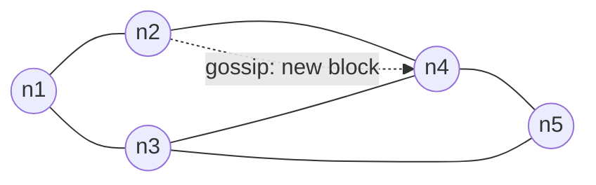
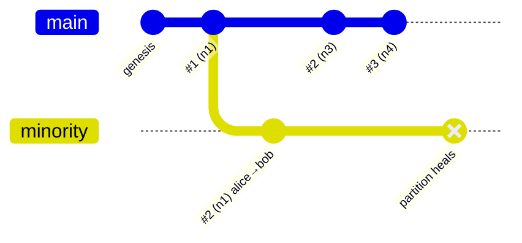
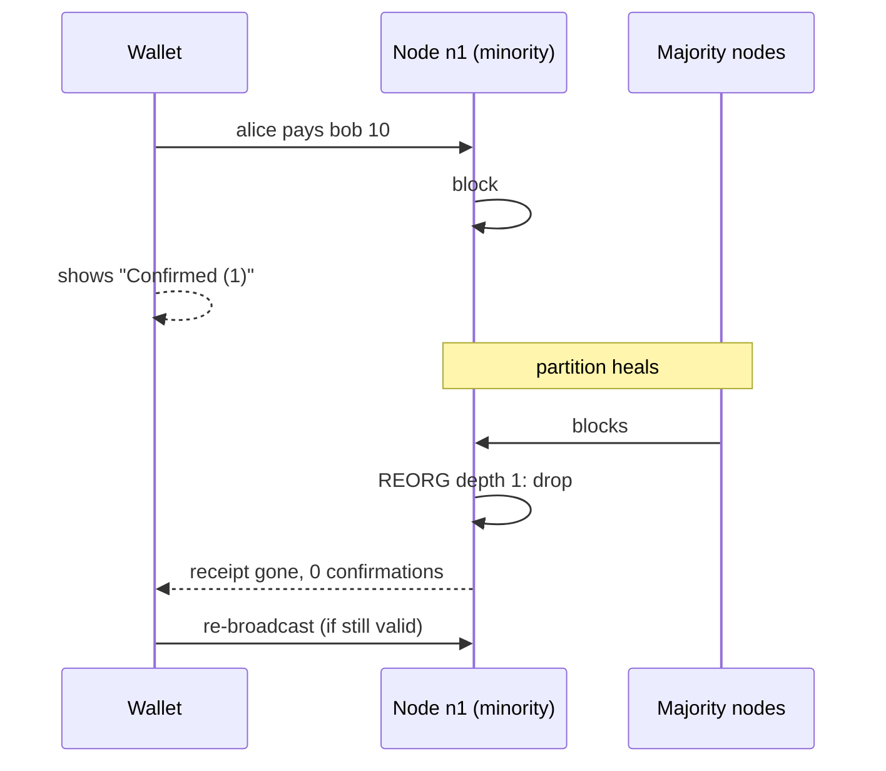
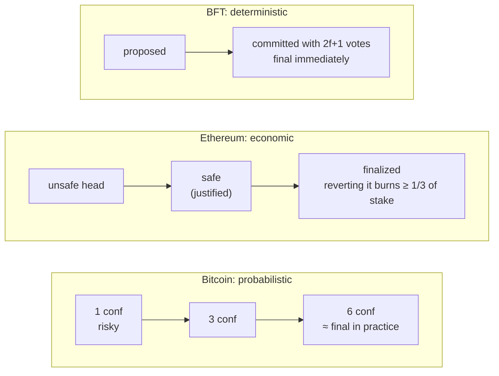
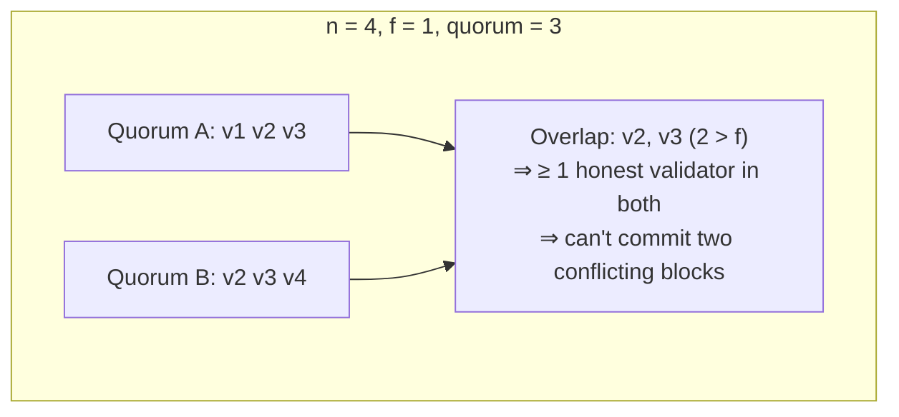
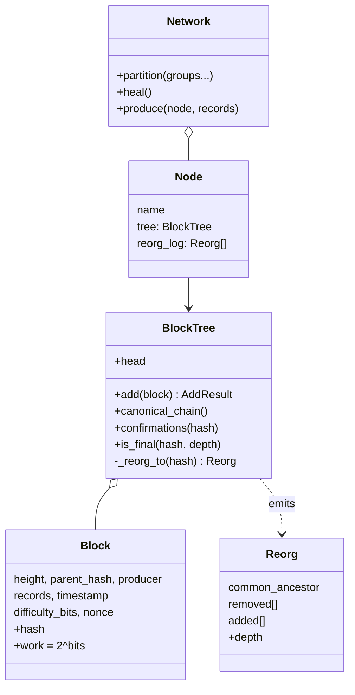
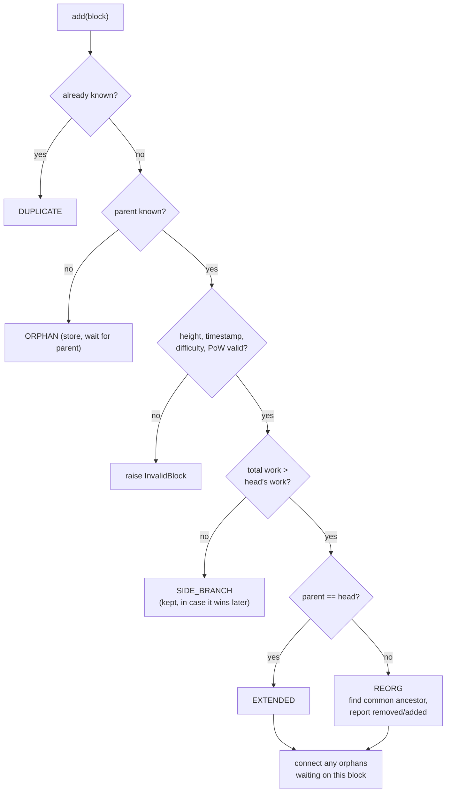

# Week 5 — Consensus, Forks, Reorganizations & Finality

> **Goal:** understand how independent nodes agree on one history, why forks
> happen, what a reorg does to "confirmed" transactions, and when a block is
> truly final. You'll simulate all of it.

---

## Part A — Concepts

### 5.1 Peer-to-peer networks

There's no central server. Each node connects to a handful of peers and
**gossips** new transactions and blocks to them.



Messages arrive at **different times** at different nodes, and sometimes not
at all (partitions). Consensus has to work anyway.

### 5.2 Consensus mechanisms compared

| | Proof of Work | Proof of Stake | Classical BFT |
|---|---|---|---|
| Who proposes | Whoever first finds `hash < target` | Pseudo-random, weighted by stake | Rotating leader among known validators |
| Sybil resistance | Hardware + energy | Locked capital | Permissioned membership |
| Fork choice | Most cumulative **work** | LMD-GHOST (most attestation weight) | No forks: commit needs 2/3 |
| Finality | Probabilistic | Economic (Casper FFG checkpoints) | Instant on commit |
| Punishment | Wasted electricity | **Slashing** of stake | Removal from validator set |
| Example | Bitcoin | Ethereum | Tendermint/CometBFT, Hyperledger BFT |
| In this repo | [block.py](consensus_sim/block.py) `mine()` | [pos.py](consensus_sim/pos.py) | [bft.py](consensus_sim/bft.py) |

### 5.3 How a fork happens and resolves



1. A **partition** (or just two miners finding blocks at the same moment)
   splits the network.
2. Each side extends its own tip. There are now **two valid chains**.
3. When the sides reconnect, every node applies the **fork-choice rule**:
   pick the branch with the most cumulative work (or stake weight).
4. Nodes on the losing branch **reorganize**: they roll back to the
   **common ancestor** and apply the winning blocks.
5. Transactions only in the dropped blocks go **back to the mempool**. If
   they conflict with the new chain (a double-spend!), they're gone for good.



> 🔑 **Engineering lesson for dApps (Weeks 11, 17):** a transaction with one
> confirmation can disappear. Your indexer and UI must handle that: wait for
> enough confirmations or the `finalized` tag, and roll back indexed data
> on reorg.

### 5.4 Fork choice: by work, not length

A "longest chain" is really the **heaviest** chain. `test_fork_choice_is_by_work_not_length`
shows a 1-block chain at difficulty 3 (work 8) beating a 3-block chain at
difficulty 0 (work 3). Without this rule, an attacker could cheaply mine
lots of easy blocks.

### 5.5 Finality



The cost of rewriting history grows with depth: the demo shows the
attacker must re-mine **every block after** the one they change.

### 5.6 Byzantine fault tolerance: why n ≥ 3f + 1?



Two properties must **both** hold:

- **Safety:** two quorums overlap in more than *f* validators, so an
  honest one is always in both.
- **Liveness:** if the *f* faulty validators go silent, the honest
  `n − f` can still form a quorum.

Surprise from the tests: with n = 3 and f = 1, the system is still *safe*,
but **not live**. One silent node stops the chain. The property test
`test_tolerates_iff_n_at_least_3f_plus_1` checks, over hundreds of random
`(n, f)` pairs, that both properties hold *exactly* when n ≥ 3f + 1.

### 5.7 Proof of Stake mechanics

- **Proposer selection** ([`select_proposer`](consensus_sim/pos.py)) is
  deterministic given `(seed, slot)`, so every node agrees without
  messaging. Over 8,000 slots, selection frequency matches stake share
  within 3%.
- **Equivocation** means signing two different blocks for the same slot.
  It's provable from two signed headers, so it's **slashable**.
- Slashing uses **integer basis points**, never floats.

---

## Part B — Architecture



### `BlockTree.add()` decision flow



---

## Part C — Step by step

```bash
cd phase-2-cryptography/week-05-consensus-forks
pip install -r requirements-dev.txt
python -m pytest --cov=consensus_sim
python -m demos.fork_story
```

1. **PoW** ([block.py](consensus_sim/block.py)): `meets_target` checks
   `int(hash) < 2^(256 − bits)`. `mine` brute-forces the nonce. Tests show
   tampering invalidates PoW and that expected work doubles per bit.
2. **Block tree** ([blocktree.py](consensus_sim/blocktree.py)): store
   *every* valid block, track cumulative work, and switch heads only on
   **strictly** more work (ties keep the first-seen block).
3. **Reorg detection**: walk both tips back to the common ancestor and
   report what was removed and added. The `Reorg` record is exactly what an
   indexer needs to roll back its database (Week 17).
4. **Network** ([network.py](consensus_sim/network.py)): each producer mines
   on its *own* head and gossips only to reachable peers. `heal()` syncs
   everything.
5. **PoS + BFT** ([pos.py](consensus_sim/pos.py), [bft.py](consensus_sim/bft.py)):
   pure functions, easy to property-test.

Demo output (abridged):

```text
2) Partition {n1,n2} | {n3,n4,n5}: both sides keep building = FORK
  n1: genesis -> #1(n1) -> #2(n1)
  n3: genesis -> #1(n1) -> #2(n3) -> #3(n4)

3) Partition heals; heaviest chain wins:
  n1 REORG depth=1: dropped [('alice pays bob 10',)]
  'alice pays bob 10' confirmed? False -> wallet must re-broadcast it

5) BFT: how many validators do we need?
  n=3   tolerates f=0  quorum=3  overlap=3
  n=4   tolerates f=1  quorum=3  overlap=2
```

## Assignment

1. **Double-spend experiment:** during a partition, have Alice spend the same
   coins on *both* sides (`"alice pays bob 10"` on the minority,
   `"alice pays carol 10"` on the majority). After healing, which payment
   survives? Write a test.
2. Add `BlockTree.finalize(hash)` that makes a block **irreversible**: any
   reorg that would remove it raises an error. This is how PoS checkpoints
   behave.
3. Journal: explain to a non-technical stakeholder why "1 confirmation" isn't
   safe for a high-value payment.

## ✅ Week 5 checklist

- [ ] I can draw a fork, identify the common ancestor and the reorg depth.
- [ ] I can explain heaviest-chain vs longest-chain.
- [ ] I can explain probabilistic vs economic vs BFT finality.
- [ ] I can explain why BFT needs n ≥ 3f + 1 (safety **and** liveness).
- [ ] I know what my dApp must do when a reorg removes a transaction.

**Next:** [Phase 3 — Week 6: Solidity basics](../../phase-3-smart-contracts/week-06-solidity-basics/)
