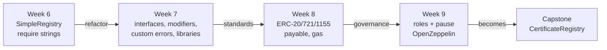

# Phase 3 — Smart Contract Engineering (Weeks 6–9)

**Deliverable:** a tested, documented smart-contract system.

| Week | Lesson | Contract(s) you build |
|------|--------|-----------------------|
| 6 | [Solidity fundamentals](week-06-solidity-basics/) | `SimpleRegistry` |
| 7 | [Modular contracts](week-07-modular-contracts/) | `IRegistry`, `Owned`, `LabelLib`, `ModularRegistry`, `DataLocations` |
| 8 | [EVM, gas & token standards](week-08-evm-gas-tokens/) | `CourseToken` (ERC-20), `AssetNFT` (ERC-721), `CourseBadges` (ERC-1155), `FeeVault`, gas lab |
| 9 | [Access control & emergency pause](week-09-access-control/) | `RoleRegistry` (AccessControl + Pausable) |



## Shared setup

All Foundry projects share **pinned** dependencies through git submodules in
the repo-root [`lib/`](../lib):

| Dependency | Version | Why pinned |
|------------|---------|-----------|
| `forge-std` | v1.16.2 | Test cheatcodes |
| `openzeppelin-contracts` | v5.6.1 | Audited standards; never take "latest" silently |
| `solc` | 0.8.28 | Set in each `foundry.toml` |

```bash
git clone --recurse-submodules <repo>       # or: git submodule update --init
cd phase-3-smart-contracts/week-06-solidity-basics
forge test
```

> **Understand what you import.** OpenZeppelin is battle-tested, but you're
> still responsible for its security assumptions in *your* system. Before
> Week 9, read the source of `AccessControl.sol` and `Pausable.sol` in
> `lib/openzeppelin-contracts`.
