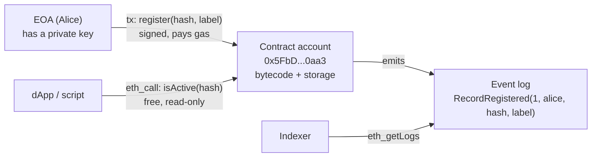
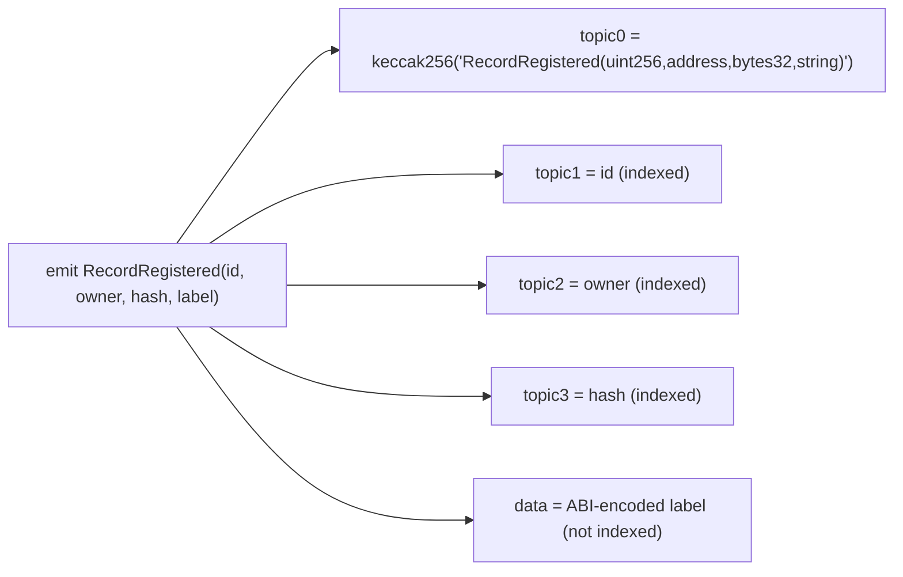
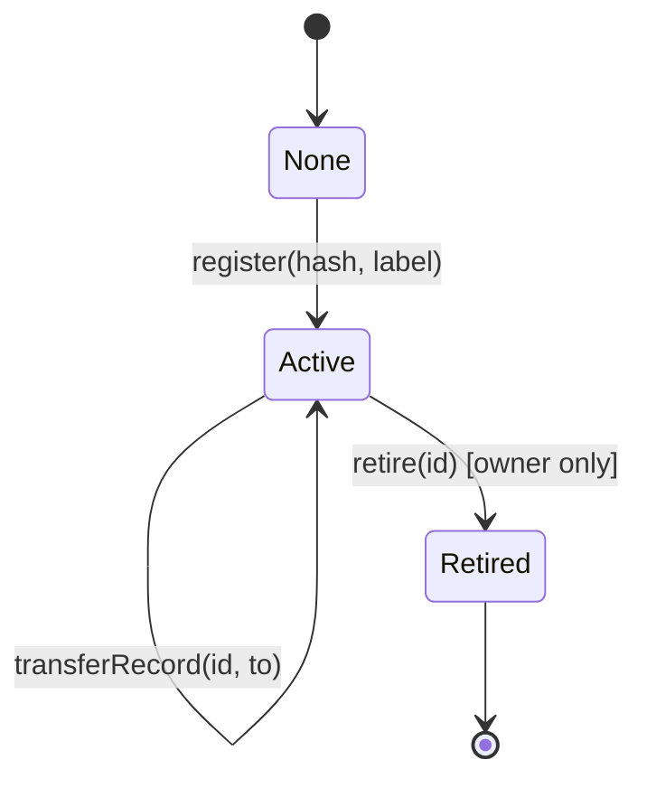
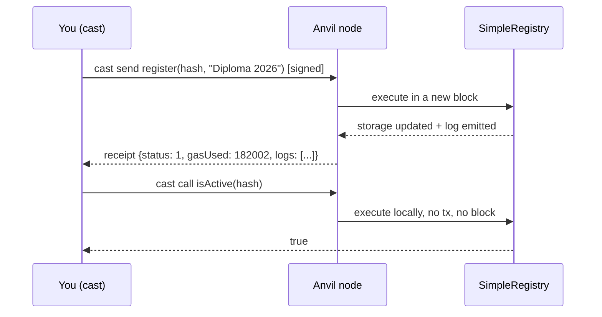

# Week 6 — Solidity Fundamentals → An On-Chain Registry

> **Goal:** write, test, deploy and interact with your first smart contract,
> a document-fingerprint registry. It's the seed of the capstone's
> certificate contract.

**New tools:** Foundry (`forge`, `anvil`, `cast`). Install: [docs/SETUP.md](../../docs/SETUP.md#week-6-foundry)

---

## Part A — Concepts

### 6.1 What a smart contract is

A smart contract is **code + storage at an address**. It runs on every node
in the EVM, and it changes state only when a **transaction** calls it.



| Contracts **can** | Contracts **cannot** |
|---|---|
| Hold ETH and tokens | Act on their own (something must send a tx) |
| Enforce rules on state changes | Read the internet (that needs oracles) |
| Call other contracts | Keep secrets. All storage is public |
| Emit events | Be changed after deployment (unless designed to be upgradeable, Week 9) |

### 6.2 Anatomy of a Solidity file

```solidity
// SPDX-License-Identifier: MIT        ← license (the compiler warns without it)
pragma solidity 0.8.28;                ← EXACT version pin = reproducible build

contract SimpleRegistry {
    enum Status { None, Active, Retired }        ← custom types
    struct Record { ... }
    uint256 public constant MAX_LABEL_LENGTH = 64; ← compile-time constant
    address public immutable DEPLOYER;            ← set once in constructor
    uint256 public recordCount;                   ← state variable (storage)
    mapping(uint256 => Record) private _records;  ← key → value store
    event RecordRegistered(...);                  ← log definition
    constructor() { ... }                         ← runs once at deploy
    function register(...) external returns (uint256 id) { ... }
}
```

### 6.3 Types you'll use daily

| Type | Example | Notes |
|------|---------|-------|
| `uint256` / `uint64` / `uint8` | `recordCount` | Overflow **reverts** since 0.8.0 |
| `int256` | — | Signed. Rarely needed |
| `bool` | `isActive` | |
| `address` | `msg.sender` | 20 bytes. `address payable` can receive ETH |
| `bytes32` | `documentHash` | Fixed size, cheap. Ideal for hashes |
| `bytes` / `string` | `label` | Dynamic, more expensive. Keep short |
| `enum` | `Status` | Stored as `uint8`. The first member is the default |
| `struct` | `Record` | Groups fields |
| `mapping(K => V)` | `idByHash` | **Every key "exists"** and returns the zero value. You can't iterate it |
| `T[]` | `uint256[]` | Dynamic arrays. Beware unbounded loops |

> 💡 **The zero-value trap.** `_records[999]` doesn't revert. It returns an
> all-zero struct. That's why `Status.None = 0` exists and why IDs start at
> 1: the code can tell *missing* apart from *present*.

### 6.4 Function visibility and mutability

| Visibility | Callable from | Use for |
|------------|---------------|---------|
| `external` | Outside only (txs, other contracts) | Public API. Can read `calldata` directly |
| `public` | Outside + inside | Auto-generated getters for state vars |
| `internal` | This contract + children | Shared helpers (Week 7 inheritance) |
| `private` | This contract only | Implementation details |

| Mutability | Reads state | Writes state | Costs gas when called by a tx |
|------------|:---:|:---:|:---:|
| (none) | ✅ | ✅ | ✅ |
| `view` | ✅ | ❌ | free via `eth_call` |
| `pure` | ❌ | ❌ | free via `eth_call` |
| `payable` | ✅ | ✅ | ✅ + can receive ETH (Week 8) |

> ⚠️ **`private` ≠ secret.** `private` only stops *other contracts* from
> reading a variable. Anyone can read raw storage with
> `cast storage <addr> <slot>`.

### 6.5 Global variables

| Variable | Meaning |
|----------|---------|
| `msg.sender` | The immediate caller (EOA or contract) |
| `msg.value` | Wei sent with the call |
| `block.timestamp` | Block time in seconds. Validators can skew it by a few seconds, so never use it for randomness |
| `block.number` | Current block height |
| `tx.origin` | The EOA that started the tx. **Never use it for authorization** (phishing risk) |

### 6.6 Events

Events are written to the transaction receipt's **logs**, not to contract
storage. Contracts can't read them, but they're far cheaper (about 8 gas per
byte of data, against roughly 625 gas per byte for new storage), and they're how
dApps and indexers learn what happened.



Up to **3 `indexed` parameters** become topics that you can **filter on** with
`eth_getLogs`. Everything else is ABI-encoded into `data`.

---

## Part B — Design

| ID | Requirement |
|----|-------------|
| FR-1 | Anyone can register a non-zero, unused `bytes32` hash with a 1–64 byte label |
| FR-2 | Only the record owner can retire or transfer it |
| FR-3 | Retired records remain readable. History isn't deleted |
| FR-4 | Every state change emits an event |
| NFR-1 | No personal data on-chain. Only (salted) hashes and short labels |



---

## Part C — Step-by-step build

```bash
cd phase-3-smart-contracts/week-06-solidity-basics
forge build       # compiles with solc 0.8.28 (pinned in foundry.toml)
forge test -vv    # runs all tests
```

### Step 1 — Project configuration ([foundry.toml](foundry.toml))

- `solc_version = "0.8.28"` pins the compiler for reproducible bytecode.
- `deny = "warnings"`: any compiler warning fails the build.
- `libs = ["../../lib"]` points at the **shared, version-pinned** dependencies
  (git submodules `forge-std@v1.16.2`, `openzeppelin-contracts@v5.6.1`).

### Step 2 — Types and storage ([SimpleRegistry.sol](src/SimpleRegistry.sol))

Read the contract top to bottom. Each section is labelled. Notice:
- the `Record` struct field order (`owner`, `status`, `registeredAt` pack
  into **one** 32-byte slot; you'll measure why that matters in Week 8);
- `idByHash` gives O(1) duplicate detection;
- NatSpec comments (`@notice`, `@param`, `@return`, `@dev`) on every
  public item.

### Step 3 — Checks → Effects → Events

```solidity
function register(bytes32 documentHash, string calldata label) external returns (uint256 id) {
    require(documentHash != bytes32(0), "SimpleRegistry: empty hash");      // CHECKS
    require(idByHash[documentHash] == 0, "SimpleRegistry: already registered");
    ...
    id = ++recordCount;                                                     // EFFECTS
    _records[id] = Record({...});
    emit RecordRegistered(id, msg.sender, documentHash, label);             // EVENT
}
```

A failed `require` **reverts** the whole transaction: every state change is
undone, but the gas used so far is still paid.

### Step 4 — `storage` vs `memory` (first look)

```solidity
Record storage record = _records[id]; // pointer into storage: writes persist
record.status = Status.Retired;       // ✅ changes the chain

Record memory copy = _records[id];    // a copy in memory
copy.status = Status.Retired;         // ❌ thrown away when the function returns
```

Week 7 covers `memory`, `storage` and `calldata` in depth, with tests.

### Step 5 — Tests ([SimpleRegistry.t.sol](test/SimpleRegistry.t.sol))

| Foundry cheatcode | What it does |
|-------------------|--------------|
| `makeAddr("alice")` | A deterministic, labelled test address |
| `vm.prank(alice)` | The **next** call has `msg.sender == alice` |
| `vm.startPrank` / `vm.stopPrank` | Every call in between comes from that address |
| `vm.expectRevert(bytes("msg"))` | The next call **must** revert with exactly this reason |
| `vm.expectEmit(t1,t2,t3,data, emitter)` | The next call must emit the event declared right after |
| `vm.warp(ts)` | Set `block.timestamp` (deterministic tests) |
| `vm.assume(cond)` | In fuzz tests, discard inputs that don't satisfy `cond` |

The test matrix covers **every rule from both sides**:

| Rule | ✅ allowed | ❌ rejected |
|------|-----------|------------|
| Non-zero hash | `test_RegisterStoresRecord` | `test_RevertWhen_HashIsZero` |
| Unique hash | `test_IdsIncrementAndTrackOwner` | `test_RevertWhen_HashAlreadyRegistered` |
| Label 1..64 | `test_LabelAtMaxLengthIsAccepted` (boundary) | `test_RevertWhen_LabelEmpty`, `..TooLong` (boundary + 1) |
| Owner-only retire | `test_OwnerCanRetire` | `test_RevertWhen_NonOwnerRetires` |
| Retire once | — | `test_RevertWhen_RetireTwice` |
| Owner-only transfer | `test_OwnerCanTransfer` | `..NonOwnerTransfers`, `..ToZeroAddress`, `..ToSelf` |
| Any valid input works | `testFuzz_RegisterAnyNonZeroHash` (1000 runs) | `testFuzz_LabelLengthBoundary` |

```text
Ran 21 tests for test/SimpleRegistry.t.sol:SimpleRegistryTest
[PASS] testFuzz_LabelLengthBoundary(uint8) (runs: 1000, μ: 100508, ~: 166424)
[PASS] testFuzz_RegisterAnyNonZeroHash(bytes32,address) (runs: 1000, μ: 174597, ~: 174597)
...
Suite result: ok. 21 passed; 0 failed; 0 skipped
```

### Step 6 — Deploy to a local chain and interact

```bash
# Terminal 1: start a local chain with 10 pre-funded PUBLIC test accounts
anvil

# Terminal 2
export RPC=http://127.0.0.1:8545
export KEY=0xac0974bec39a17e36ba4a6b4d238ff944bacb478cbed5efcae784d7bf4f2ff80  # Anvil #0, public test key ONLY

forge script script/DeploySimpleRegistry.s.sol --rpc-url $RPC --broadcast --private-key $KEY
# == Logs ==  SimpleRegistry deployed at 0x5FbDB2315678afecb367f032d93F642f64180aa3

export REG=0x5FbDB2315678afecb367f032d93F642f64180aa3
HASH=$(cast keccak "salt-1|diploma-pdf-bytes")

cast send $REG "register(bytes32,string)" $HASH "Diploma 2026" --private-key $KEY --rpc-url $RPC
# status 1 (success)   gasUsed 182002

cast call $REG "isActive(bytes32)(bool)" $HASH --rpc-url $RPC      # true
cast call $REG "recordCount()(uint256)" --rpc-url $RPC             # 1

cast logs --from-block 0 --address $REG \
  "RecordRegistered(uint256 indexed,address indexed,bytes32 indexed,string)" --rpc-url $RPC

# Try a duplicate: the node simulates it first and refuses
cast send $REG "register(bytes32,string)" $HASH "dup" --private-key $KEY --rpc-url $RPC
# Error: ... execution reverted: SimpleRegistry: already registered
```



### Step 7 — Gas report

```bash
forge test --gas-report
```

| Function | Median gas | Why |
|----------|-----------:|-----|
| Deployment | 813,549 | Bytecode size 3,561 bytes × 200 gas/byte + init |
| `register` | ~174k | 4 new storage slots (20k each) + string + array push + event |
| `getRecord` (view) | ~8k | Free off-chain via `eth_call`. The cost only matters when called on-chain |
| `isActive` (view) | ~4.8k | |

Storing new data (**SSTORE 0 → non-zero = 20,000 gas**) dominates. Week 8
shows how to reduce it.

---

## Common mistakes

| Mistake | Fix |
|---------|-----|
| `pragma solidity ^0.8.0;` in an application | Pin an exact version |
| Using id 0 as a valid id | Start at 1. 0 means "missing" |
| Forgetting a `require` on ownership | Write the ❌ test **first** |
| Storing names or emails on-chain | Store a salted hash only |
| `tx.origin == owner` | Use `msg.sender` |
| Loops over unbounded arrays in write functions | Use mappings, pagination, or off-chain indexing |

## Assignment

1. Add `updateLabel(uint256 id, string calldata newLabel)` (owner-only, active
   records only) with an event. Write ✅ and ❌ tests first.
2. Add a view `recordByHash(bytes32)` that returns the full record or reverts.
3. Use `cast storage $REG 0` to read `recordCount` straight from storage. Then
   explain in your journal why `private` isn't secret.

## ✅ Week 6 checklist

- [ ] `forge build` produces **zero warnings**; `forge lint` is clean.
- [ ] Every rule has a passing ✅ test *and* a ❌ revert test.
- [ ] I deployed to Anvil and used `cast send`, `cast call` and `cast logs`.
- [ ] I can explain `external` vs `public`, `view` vs `pure`, `storage` vs `memory`.
- [ ] Every public function has NatSpec.

**Next:** [Week 7 — Modular contracts](../week-07-modular-contracts/)
