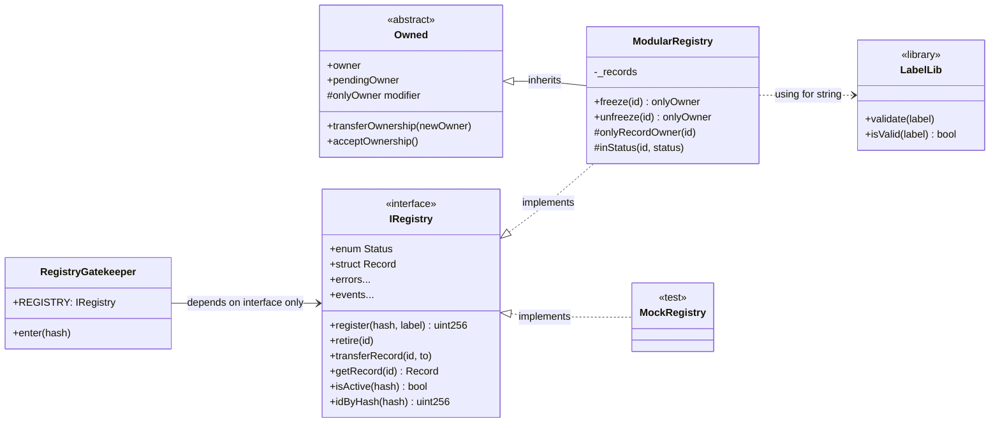
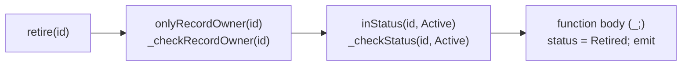

# Week 7 — Modular Contracts: Interfaces, Inheritance, Modifiers, Errors, Libraries

> **Goal:** refactor Week 6's single-file registry into small parts with one
> job each, and *measure* the effect of each Solidity feature instead of
> taking it on faith.

---

## Part A — Concepts

### 7.1 From one file to composed modules



| Module | Single responsibility | Solidity feature |
|--------|----------------------|------------------|
| [IRegistry.sol](src/interfaces/IRegistry.sol) | *What* the registry offers | `interface`, custom `error`s, events |
| [Owned.sol](src/access/Owned.sol) | *Who* is admin | `abstract contract`, `modifier`, constructor args |
| [LabelLib.sol](src/libraries/LabelLib.sol) | *Rules* for labels | `library`, `using ... for` |
| [ModularRegistry.sol](src/ModularRegistry.sol) | *How* state changes | Inheritance, `override`, `@inheritdoc` |
| [RegistryGatekeeper.sol](src/RegistryGatekeeper.sol) | A consumer | Depends on an interface (dependency inversion) |
| [DataLocations.sol](src/labs/DataLocations.sol) | Lab | `storage` / `memory` / `calldata` |
| [ErrorStyles.sol](src/labs/ErrorStyles.sol) | Lab | `require` strings vs custom errors |

### 7.2 Interfaces

An interface declares functions, events, errors, structs and enums, **with no
implementation and no state**. Anything that talks to the registry (other
contracts, the frontend ABI, test mocks) can depend on `IRegistry` alone.

```solidity
RegistryGatekeeper gate = new RegistryGatekeeper(mock);      // unit test with a mock
RegistryGatekeeper gate = new RegistryGatekeeper(registry);  // integration test, real thing
```

### 7.3 Modifiers



Modifiers run **left to right**, wrapping the body at `_;`. Best practice:
put the logic in an `internal` function and call it from the modifier.
Modifier code is **inlined into every function** that uses it, so a fat
modifier bloats bytecode.

### 7.4 Inheritance

```solidity
contract ModularRegistry is IRegistry, Owned {
    constructor(address initialOwner) Owned(initialOwner) {}   // pass parent ctor args
```

- List parents from **most base-like to most derived**. Solidity resolves
  multiple inheritance with C3 linearization (right-most wins on conflicts).
- `abstract` contracts can't be deployed. They exist to be inherited.
- `override` is required when you implement an interface function or replace
  a `virtual` parent function.
- `/// @inheritdoc IRegistry` copies NatSpec from the interface.

### 7.5 Custom errors

```solidity
// Week 6
require(record.owner == msg.sender, "SimpleRegistry: not owner");
// Week 7
if (record.owner != msg.sender) revert NotRecordOwner(id, msg.sender);
```

Measured by [`GasComparisonTest`](test/Labs.t.sol):

| | `require("long string")` | `revert CustomError(addr)` | Saving |
|---|---:|---:|---:|
| Runtime bytecode | 351 bytes | 260 bytes | −26% |
| Gas for the reverting call | 844 | 738 | −13% |

Custom errors also carry **typed data**. A frontend decodes
`NotRecordOwner(7, 0xBob…)` and can show a precise message.

Testing them:

```solidity
vm.expectRevert(IRegistry.EmptyHash.selector);                                   // no args
vm.expectRevert(abi.encodeWithSelector(IRegistry.NotRecordOwner.selector, id, bob)); // with args
```

### 7.6 Libraries

```solidity
library LabelLib { function validate(string calldata label) internal pure { ... } }
contract ModularRegistry { using LabelLib for string;  ...  label.validate(); }
```

- **`internal` library functions are inlined** at compile time: no separate
  deployment, no `DELEGATECALL`.
- `public`/`external` library functions *are* deployed separately and
  linked. That's rarely needed.
- Libraries have no state and can't receive ETH. They're ideal for pure
  validation and maths.

### 7.7 `storage` vs `memory` vs `calldata`

| Location | Lifetime | Mutable? | Cost | Typical use |
|----------|----------|:---:|------|-------------|
| `storage` | Permanent (on-chain) | ✅ | Very high (SSTORE 2.9k–20k gas) | State variables, `Record storage r = _records[id]` |
| `memory` | During the call | ✅ | Low, but grows quadratically | Building return values, temp structs |
| `calldata` | During the call | ❌ read-only | Lowest (no copy) | `external` function params |
| stack | During the call | ✅ | Cheapest | Value-type locals (`uint256 x`) |

Proven by [`DataLocationsTest`](test/Labs.t.sol):

- `Record storage ref = ...; ref.value = 42;` → **persists**.
- `Record memory copy = ...; copy.value = 42;` → storage **unchanged**.
- Summing 50 numbers: **calldata 14,220 gas vs memory 18,443 gas** (calldata is ~23% cheaper).

> 🧪 **Measurement lesson.** The first version of this test "proved" that
> memory was *cheaper*. The reason: the first call to any address pays
> ~2,500 extra gas for **cold account access** (EIP-2929), and calldata
> happened to run first. Warming the address up first fixed the comparison.
> Whenever you benchmark gas, control for cold vs warm access.

---

## Part B — Step by step

```bash
cd phase-3-smart-contracts/week-07-modular-contracts
forge build && forge test -vv && forge lint
```

1. **Extract the interface.** Move types, errors, events and function
   signatures from Week 6 into `IRegistry`. Make the contract `is IRegistry`
   and add `override`.
2. **Replace every `require` with a custom error** that carries the data a
   user needs (`AlreadyRegistered(hash, existingId)`).
3. **Extract `Owned`.** Two-step transfer: `transferOwnership` → `acceptOwnership`.
   A typo'd address can never become owner, because it can't call accept.
4. **Extract `LabelLib`.** Add a character-set rule (printable ASCII only)
   that blocks control characters and look-alike Unicode in UI labels.
5. **Add modifiers** `onlyRecordOwner` and `inStatus`, with logic in `_check*` functions.
6. **Add a privileged feature**: `freeze`/`unfreeze` for disputes.
   **Write down the trust assumption**: users must trust the owner not to
   freeze records arbitrarily. Week 9 replaces the single owner with roles
   and Week 15 puts it behind a multisig.
7. **Write a consumer against the interface** and test it with a mock (unit)
   *and* the real registry (integration).

### Test inventory (30 tests)

| Suite | Kind | What it proves |
|-------|------|----------------|
| `ModularRegistryTest` (16) | unit + fuzz | Every custom error fires with the right arguments; freeze blocks owner actions; two-step ownership |
| `LabelLibTest` (5) | unit + **property** | `validate` reverts ⟺ `isValid` is false, over 1,000 random strings |
| `RegistryGatekeeperUnitTest` (3) | unit with **mock** | Gate logic in isolation |
| `RegistryGatekeeperIntegrationTest` (1) | integration | Gate + real registry + admin freeze |
| `DataLocationsTest` (4) | lab | storage/memory/calldata semantics and gas |
| `GasComparisonTest` (1) | lab | Custom errors are smaller and cheaper |

## Design review questions (answer in your journal)

1. `freeze` gives the owner power over users' records. Who should hold it?
   What would you show users so they can make an informed choice?
2. `RegistryGatekeeper` trusts whatever `IRegistry` it's given at deploy time.
   What could a malicious registry do to it? (Hint: re-entrancy, gas griefing, lies.)
3. Why are internal library functions safer than `delegatecall`-linked ones?

## Assignment

1. Add a `RecordLib` library with `function isTransferable(Record storage r) internal view returns (bool)`.
   Use it in `transferRecord`.
2. Add `renounceOwnership()` to `Owned`, then argue in an ADR whether the
   registry *should* expose it. (What happens to frozen records?)
3. Write a second mock that **reverts** on `isActive`. What does the
   gatekeeper do? Is that the behaviour you want?

## ✅ Week 7 checklist

- [ ] No `require` strings remain. Every error is a typed custom error.
- [ ] Each file has one responsibility I can state in a sentence.
- [ ] I tested a consumer with a mock *and* with the real dependency.
- [ ] I can explain when to use `storage`, `memory` and `calldata`, with numbers.
- [ ] I know why gas benchmarks must control for cold/warm access.

**Next:** [Week 8 — EVM, gas & token standards](../week-08-evm-gas-tokens/)
