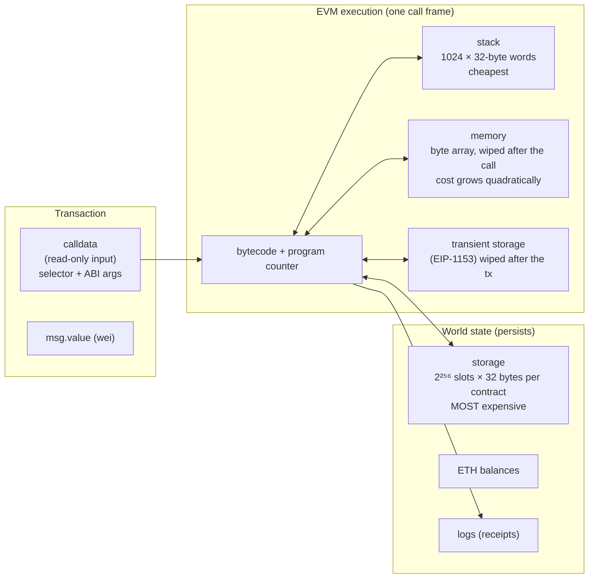
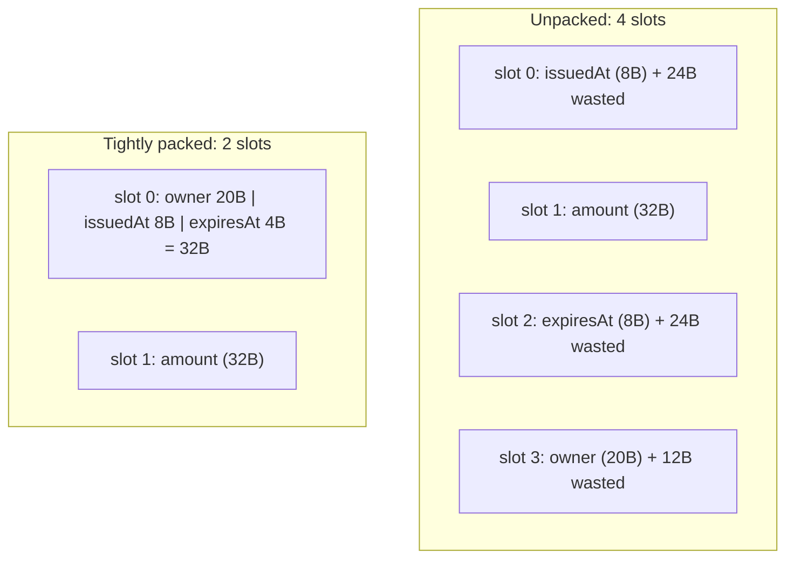
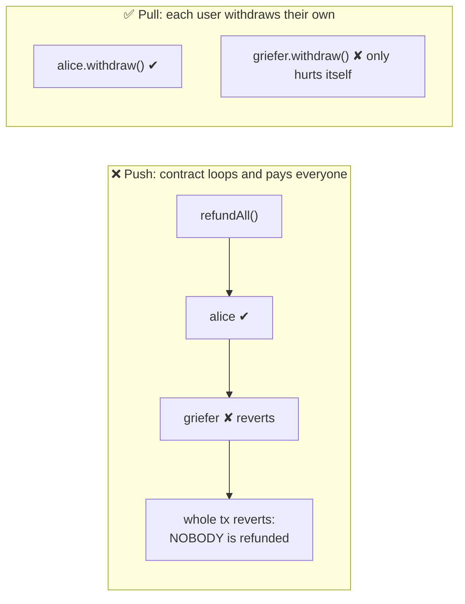
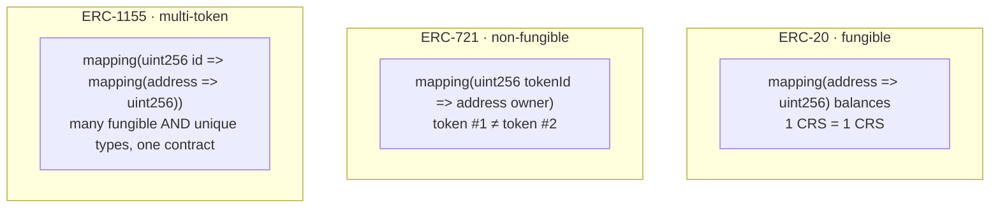
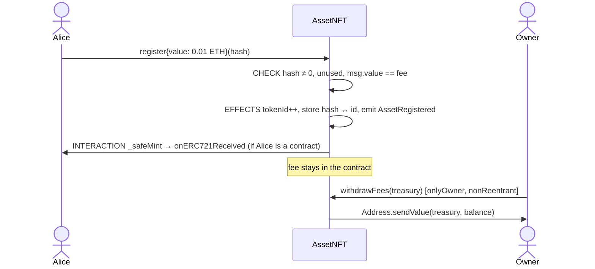

# Week 8 — The EVM, Gas, Payable Functions & Token Standards

> **Goal:** understand what your Solidity becomes inside the EVM and what each
> operation costs, move ETH safely, and build on the three token standards
> (ERC-20, ERC-721, ERC-1155) with OpenZeppelin.

---

## Part A — Inside the EVM

### 8.1 The machine



How a call finds its function: the first **4 bytes of calldata** are the
**function selector**, `bytes4(keccak256("register(bytes32)"))`.

```bash
cast sig "register(bytes32)"     # 0xe1fa8e84
cast calldata "register(bytes32)" 0x1111111111111111111111111111111111111111111111111111111111111111
# 0xe1fa8e84 1111...1111   ← selector, then the 32-byte argument
```

### 8.2 What things cost (post-Berlin/London/Cancun)

| Operation | Gas | Notes |
|-----------|----:|-------|
| Base cost of any tx | 21,000 | A plain ETH transfer costs exactly this |
| Calldata byte (zero / non-zero) | 4 / 16 | |
| `ADD`, `MUL`, `LT` … | 3–5 | Arithmetic is cheap |
| Memory word | 3 + quadratic | |
| `SLOAD` cold / warm | 2,100 / 100 | First access in a tx is "cold" (EIP-2929) |
| `SSTORE` 0 → non-zero | 22,100 | Creating storage is the most expensive common op |
| `SSTORE` non-zero → non-zero | ~5,000 (cold) / 2,900 | |
| `SSTORE` non-zero → 0 | refund (capped) | Clearing storage gives some gas back |
| `CALL` to cold address | 2,600 + | Plus 9,000 if it sends value |
| `LOG` | 375 + 375/topic + 8/byte | Events are cheap storage for off-chain readers |
| `CREATE` contract | 32,000 + 200/byte of code | |

**Total fee** = `gasUsed × (baseFee + priorityFee)`. The base fee is burned and
the tip goes to the validator (EIP-1559, see Week 3).

### 8.3 Storage packing (measured in [GasLab](src/labs/GasLab.sol))



| Layout | Slots written | Gas (fresh write) |
|--------|:---:|---:|
| `Unpacked` | 4 | 69,948 |
| `PartlyPacked` (fields fit badly) | 3 | 67,403 |
| `TightlyPacked` | 2 | **45,282 (−35%)** |

Rule: **order struct fields so small types sit next to each other and add up
to ≤ 32 bytes.** Week 6's `Record` already does this: `owner` (20) +
`status` (1) + `registeredAt` (8) share one slot.

### 8.4 Caching storage reads

| Loop over 100 storage values | Gas |
|---|---:|
| `for (i = 0; i < values.length; i++) total += values[i];` | 94,592 |
| cache `length`, accumulate on the stack, write `total` once, `unchecked { ++i; }` | **63,628 (−33%)** |

> 🧪 **Fair measurement.** A Foundry test is *one transaction*. If both loops
> ran on the same contract, the second would find every slot already warm.
> The test gives each loop its own instance.

### 8.5 Reverts and gas

- `revert` / failed `require` / custom error: **all state changes are undone**,
  but gas used so far is **charged**, and the remaining gas is refunded.
- Out of gas: everything is undone and **all** gas is consumed.
- `assert` failures and arithmetic over/underflow (≥0.8) revert with
  `Panic(uint256)`.

---

## Part B — Moving ETH safely

### 8.6 `payable`, `msg.value`, `receive`

```solidity
function register(bytes32 h) external payable { if (msg.value != registrationFee) revert WrongFee(...); }
receive() external payable {}          // plain ETH sent with empty calldata
fallback() external payable {}         // unknown selector (use sparingly)
```

A function **without** `payable` rejects any ETH sent to it.

### 8.7 `transfer` vs `send` vs `call`

| Method | Gas forwarded | On failure | Verdict |
|--------|---------------|------------|---------|
| `to.transfer(x)` | 2,300 | reverts | ❌ Breaks smart wallets (`test_TransferFailsForSmartWallet`) |
| `to.send(x)` | 2,300 | returns `false` | ❌ Same problem, and easy to ignore |
| `to.call{value: x}("")` | all remaining | returns `false` | ✅ **check the result**, apply CEI / reentrancy guard |
| `Address.sendValue(to, x)` (OZ) | all remaining | reverts | ✅ What `AssetNFT.withdrawFees` uses |

### 8.8 Push vs pull payments



Proven by `test_PushRefundsAreDoSedByOneRefuser` and
`test_PullRefundsIsolateTheRefuser`. `PullRefunder.withdraw` also zeroes
the balance **before** sending (checks-effects-interactions), which defends
against re-entrancy (Week 14).

---

## Part C — Token standards



| | ERC-20 | ERC-721 | ERC-1155 |
|---|---|---|---|
| Represents | Currency, points, shares | Unique assets: deeds, tickets, art | Game items, badges, mixed collections |
| Balance | `balanceOf(owner)` | `ownerOf(id)`, `balanceOf(owner)` | `balanceOf(owner, id)` |
| Approve | `approve(spender, amount)` | `approve(to, id)` / `setApprovalForAll` | `setApprovalForAll` only |
| Batch | ❌ | ❌ | ✅ `safeBatchTransferFrom` |
| Receiver hook | ❌ (tokens can get stuck in contracts) | `onERC721Received` (with `safe*`) | `onERC1155Received` (always) |
| Built here | [CourseToken](src/CourseToken.sol) | [AssetNFT](src/AssetNFT.sol) | [CourseBadges](src/CourseBadges.sol) |

### 8.9 What you write vs what you inherit

```solidity
contract CourseToken is ERC20Capped, Ownable {
    constructor(address initialOwner, uint256 cap_)
        ERC20("Course Token", "CRS") ERC20Capped(cap_) Ownable(initialOwner) {}
    function mint(address to, uint256 amount) external onlyOwner { _mint(to, amount); }
}
```

That's the whole token: about 10 lines of your own, on top of hundreds of
audited ones. **Read what you inherit**: `lib/openzeppelin-contracts/contracts/token/ERC20/ERC20.sol`.
Note the OZ v5 custom errors (`ERC20InsufficientAllowance`, `ERC721InvalidReceiver`, …)
from ERC-6093, which the tests assert on.

### 8.10 The asset registry as an NFT

`AssetNFT.register(hash)` combines this week's ideas:



---

## Part D — Run it

```bash
cd phase-3-smart-contracts/week-08-evm-gas-tokens
forge build                          # also runs forge-lint; warnings fail the build
forge test -vv                       # 30 tests, prints gas-lab numbers
forge test --gas-report              # per-function gas table
forge inspect AssetNFT storageLayout # see which slot each variable lives in
```

### Lint findings we fixed (and one we justified)

| Finding | Fix |
|---------|-----|
| `erc20-unchecked-transfer` in tests | `assertTrue(token.transfer(...))`. Some tokens return `false` instead of reverting. In production use `SafeERC20` |
| `named-struct-fields` | `Unpacked({issuedAt: ..., amount: ...})`, which can't silently swap two same-typed fields |
| `mixed-case-variable` | `_baseTokenURI` → `_baseTokenUri` |
| `mixed-case-function` on `_baseURI` | **Suppressed with a comment**: the name is OpenZeppelin's, and we must override it |

## Assignment

1. Add `ERC20Permit` to `CourseToken` (gasless approvals via signatures) and
   test `permit` with `vm.sign`.
2. Make `AssetNFT` emit an [ERC-4906](https://eips.ethereum.org/EIPS/eip-4906)
   `MetadataUpdate` event when the base URI changes.
3. Use `forge inspect GasLab storageLayout` to verify the slot numbers in §8.3.

## ✅ Week 8 checklist

- [ ] I can explain storage vs memory vs stack vs calldata in terms of gas.
- [ ] I know why `SSTORE` 0 → non-zero dominates costs, and how packing helps.
- [ ] I never use `transfer`/`send`, and I check `call` results.
- [ ] I can choose between ERC-20, ERC-721 and ERC-1155 for a use case.
- [ ] I read the OZ source of every contract I inherited.

**Next:** [Week 9 — Access control & emergency pause](../week-09-access-control/)
