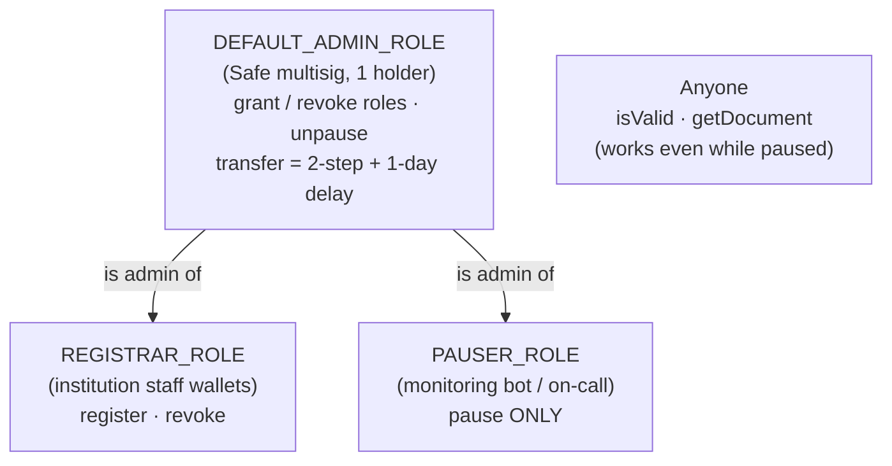
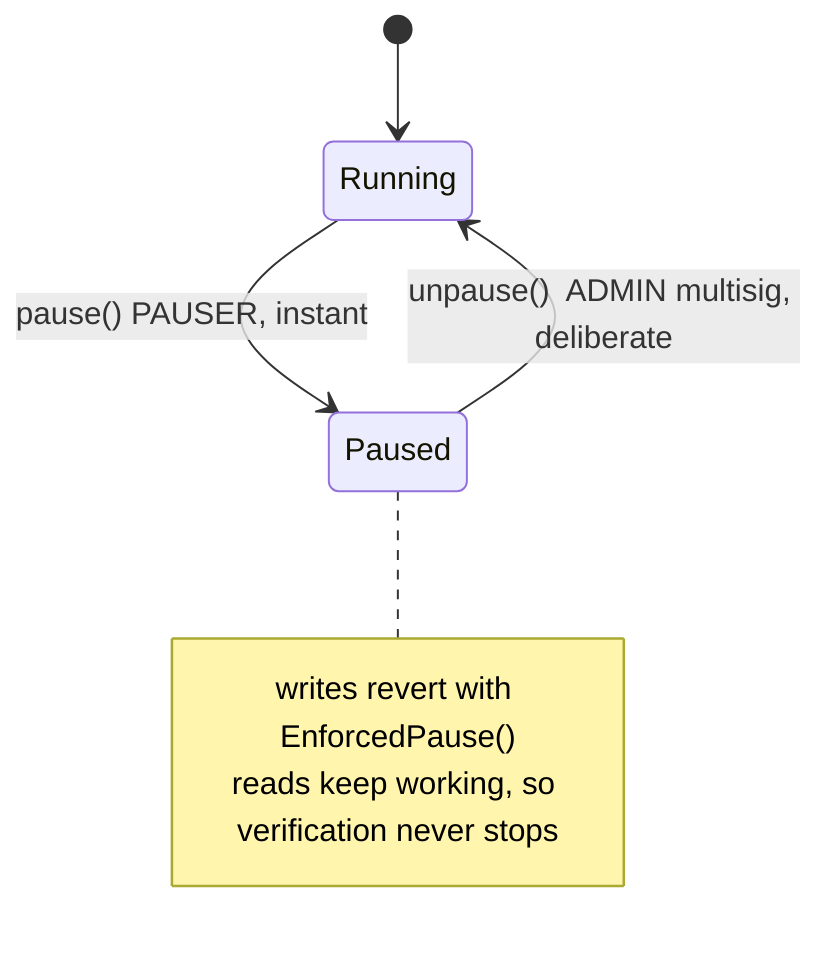
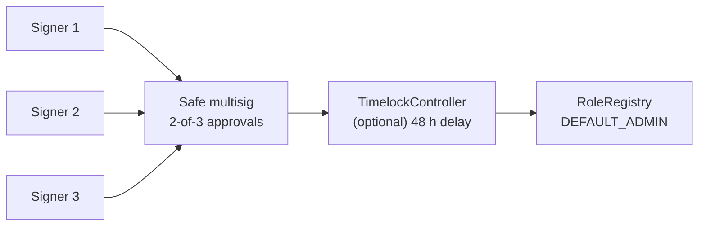
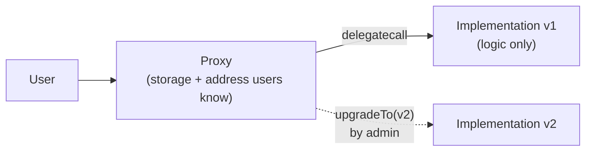

# Week 9 — Access Control, Emergency Pause & Upgradeability Trade-offs

> **Goal:** decide *who* may do *what*, enforce it with audited OpenZeppelin
> components, add a circuit breaker for emergencies, and make a reasoned,
> documented decision about upgradeability.

---

## Part A — Concepts

### 9.1 From one owner to roles

| Model | Who can act | Good for | Risk |
|-------|-------------|----------|------|
| No access control | Anyone | Fully permissionless registries (Week 6) | Spam; no curation |
| `Ownable` (single owner) | One address | Small contracts, prototypes | One key = total control; one point of failure |
| **Role-based (`AccessControl`)** | Many accounts, each with only the rights it needs | Real organizations | Role sprawl if you don't document it |
| Multisig + timelock on top | M-of-N signers, then a waiting period | Production governance | Slower to act (by design) |

**Principle of least privilege:** each account gets exactly the rights its
job needs and nothing more. In `RoleRegistry` even the **admin can't
register documents**. Governance and operations are separate.

### 9.2 The roles in `RoleRegistry`



| | `register` | `revoke` | `pause` | `unpause` | `grantRole` | read |
|---|:---:|:---:|:---:|:---:|:---:|:---:|
| admin | ✘ | ✘ | ✘ | ✔ | ✔ | ✔ |
| registrar | ✔ | ✔ | ✘ | ✘ | ✘ | ✔ |
| pauser | ✘ | ✘ | ✔ | ✘ | ✘ | ✔ |
| anyone | ✘ | ✘ | ✘ | ✘ | ✘ | ✔ |

This table **is** the test plan: `test_Matrix_*` checks every cell.

### 9.3 How `AccessControl` works

```solidity
bytes32 public constant REGISTRAR_ROLE = keccak256("REGISTRAR_ROLE");
mapping(bytes32 role => RoleData) _roles;    // RoleData { mapping(address => bool) hasRole; bytes32 adminRole; }

function register(bytes32 h) external onlyRole(REGISTRAR_ROLE) whenNotPaused { ... }
```

- Every role has an **admin role** that can grant and revoke it. By default
  that's `DEFAULT_ADMIN_ROLE` (`0x00`).
- A failure reverts with `AccessControlUnauthorizedAccount(account, neededRole)`.
- `renounceRole` lets an account drop its own role (staff leaving).

**`AccessControlDefaultAdminRules`** adds guardrails to the most dangerous role:

| Guardrail | Why |
|-----------|-----|
| Exactly **one** default admin | No forgotten extra admins |
| `grantRole(DEFAULT_ADMIN_ROLE, x)` is **forbidden** | Admin can't be handed over by accident |
| Transfer = `beginDefaultAdminTransfer` → wait `delay` → `acceptDefaultAdminTransfer` | A typo'd address can't accept; observers get time to react to a malicious transfer |
| `cancelDefaultAdminTransfer` | Undo a mistake during the delay |

### 9.4 Emergency pause, designed asymmetrically



- **Pausing is cheap and fast:** one low-privilege key, which a monitoring bot
  can hold.
- **Unpausing is expensive and deliberate:** the multisig decides once the
  incident is understood.
- **A compromised pauser key can cause downtime, but never data changes.**
  That's the worst case, and you can write it down in your threat model.
- **Reads aren't paused:** an employer verifying a certificate mid-incident
  still gets an answer.

> ⚠️ A pause is a *centralization* power. Users must trust the pauser not to
> censor them. Document it, keep it narrow, and consider a maximum pause
> duration for high-stakes systems.

### 9.5 Multisig and timelock



In production, `DEFAULT_ADMIN` should be a [Safe](https://safe.global)
multisig (no single key can act), optionally behind OpenZeppelin's
`TimelockController` (every admin action is announced and delayed). For
local learning, Anvil account #0 plays the multisig.

### 9.6 Upgradeability: understand the trade-offs before you choose



| Option | How it works | ✅ | ❌ |
|--------|-------------|----|----|
| **Immutable + redeploy** | No proxy. New version = new address; migrate or point clients to it | Simplest; code can never change under users; easy to audit | Migration effort; address changes |
| Transparent proxy | Proxy routes admin calls vs user calls | Mature tooling | Extra gas per call; admin is a huge power |
| UUPS proxy | Upgrade logic lives in the implementation | Cheaper than transparent | Forget `_authorizeUpgrade` (or ship an implementation without it) and you can brick it |
| Beacon proxy | Many proxies share one implementation pointer | Upgrade a fleet at once | Same trust issues, multiplied |
| Diamond (EIP-2535) | Many facets behind one proxy | Bypasses size limit | Complex; hard to audit |

Proxy pitfalls you must understand before using one: **storage-layout
collisions** between versions, **uninitialized implementations** (use
`initializer`, and `_disableInitializers()` in the constructor), and the
fact that **upgrade rights = the right to change all logic and steal
everything**. An upgradeable contract is only as trustworthy as whoever
holds the upgrade key.

#### ADR-0002 (course decision): no proxy for the registry

- **Context:** a certificate registry's value comes from users trusting that
  rules *can't* change silently. It holds no funds, and its logic is small.
- **Decision:** deploy **immutable** contracts. If a v2 is needed, deploy it
  at a new address, keep v1 readable forever, and have the verification
  portal check both (v2 first, falling back to v1).
- **Consequences:** ✅ no upgrade key to steal; ✅ simpler audit; ⚠️ migration
  plan required (documented in Week 16's release checklist).

### 9.7 OpenZeppelin components used so far, and what they assume

| Component | Assumption you're accepting |
|-----------|------------------------------|
| `Ownable` | The owner key is safe. Losing it is permanent |
| `AccessControlDefaultAdminRules` | The admin is honest and secure. The delay is long enough for humans to notice |
| `Pausable` | Pausers are honest, and pausing doesn't trap funds forever |
| `ReentrancyGuard` | Protects only functions marked `nonReentrant` |
| `ERC721._safeMint` | Calls untrusted receiver code. Your state must already be final |

**Read the source** in `lib/openzeppelin-contracts/contracts/access/` and
`utils/Pausable.sol`. They're short.

---

## Part B — Build and test

```bash
cd phase-3-smart-contracts/week-09-access-control
forge build && forge test -vv
```

1. **Write the role matrix first** (§9.2), as a comment in the test file.
2. Inherit `AccessControlDefaultAdminRules(delay, admin)` and `Pausable`.
3. Guard writes with `onlyRole(...)` **and** `whenNotPaused`. Leave views unguarded.
4. `pause()` → `PAUSER_ROLE`; `unpause()` → `DEFAULT_ADMIN_ROLE`.
5. Record **accountability**: which registrar acted, and when (`registeredAt`,
   `revokedAt`), plus a `reason` code in the revoke event.
6. Write tests for each matrix cell, the pause behaviour, admin transfer
   timing, and fuzz tests.

### Test inventory (21 tests)

| Group | Tests |
|-------|-------|
| Role matrix | `test_Matrix_Register`, `_Revoke`, `_Pause`, `_Unpause`, `_GrantRole` |
| Pause | blocks writes · reads still work · can't pause twice · can't unpause while running |
| Lifecycle | accountability fields · revoke time and reason · no re-register after revoke · unknown/double revoke · empty hash |
| Role management | revoked registrar loses access · renounce · admin can't be granted directly · 2-step delayed transfer · cancel |
| Fuzz | only registrars register (any address) · `activeCount` matches any sequence of operations |

---

## Part C — Environment-driven deployment and an incident drill

[`script/DeployRoleRegistry.s.sol`](script/DeployRoleRegistry.s.sol) reads its
configuration from environment variables, so **the same script** serves local,
testnet and production. Only the `.env` changes.

```bash
cp .env.example .env         # .env is git-ignored. Edit addresses for your network.
set -a && source .env && set +a
anvil &                      # local chain

forge script script/DeployRoleRegistry.s.sol --rpc-url $RPC_URL --broadcast \
  --private-key 0xac0974bec39a17e36ba4a6b4d238ff944bacb478cbed5efcae784d7bf4f2ff80   # Anvil #0 (public test key)
```

**Incident drill** (verified output):

```bash
R=0x5FbDB2315678afecb367f032d93F642f64180aa3
K_REG=0x59c6995e998f97a5a0044966f0945389dc9e86dae88c7a8412f4603b6b78690d   # Anvil #1 = registrar
K_PAU=0x5de4111afa1a4b94908f83103eb1f1706367c2e68ca870fc3fb9a804cdab365a   # Anvil #2 = pauser
D=$(cast keccak "salt|transcript")

cast send $R "register(bytes32)" $D --private-key $K_REG --rpc-url $RPC_URL   # status 1 (success)
cast send $R "pause()"              --private-key $K_PAU --rpc-url $RPC_URL   # 🚨 incident: pause
cast send $R "register(bytes32)" $(cast keccak other) --private-key $K_REG ...
#   execution reverted: custom error 0xd93c0665      → cast decode-error 0xd93c0665 → EnforcedPause()
cast call $R "isValid(bytes32)(bool)" $D --rpc-url $RPC_URL                   # true (reads still work)
cast send $R "unpause()" --private-key $K_PAU ...
#   custom error 0xe2517d3f → AccessControlUnauthorizedAccount(pauser, 0x00 = DEFAULT_ADMIN_ROLE)
cast send $R "unpause()" --private-key $ADMIN_KEY ...                          # admin resumes
```

## Assignment

1. Add an `AUDITOR_ROLE` that can read a paginated list of registrations
   (`documentsBy(registrar, offset, limit)`). Why is an auditor role pointless
   for *reads* on a public chain? Rewrite the feature as an **event-based**
   off-chain report instead.
2. Add a maximum pause duration: after 7 days, anyone can call `unpause()`.
   Write the tests. Then write an ADR: is this safer or more dangerous?
3. Put the admin behind a `TimelockController` in a test and show that
   `grantRole` only executes after the delay.

## ✅ Week 9 checklist

- [ ] My role matrix exists as a table, and every cell has a test.
- [ ] Pausing is fast and narrow, unpausing is deliberate, and reads are never paused.
- [ ] The admin is a single, delayed, two-step-transferable role (multisig in production).
- [ ] I can explain the proxy pattern, storage collisions, and why upgrade keys are powerful.
- [ ] I wrote down my upgradeability decision as an ADR.

**Phase 3 complete.** Next: [Phase 4 — Week 10: Frontend & wallet connection](../../phase-4-dapp/week-10-frontend-wallet/)
