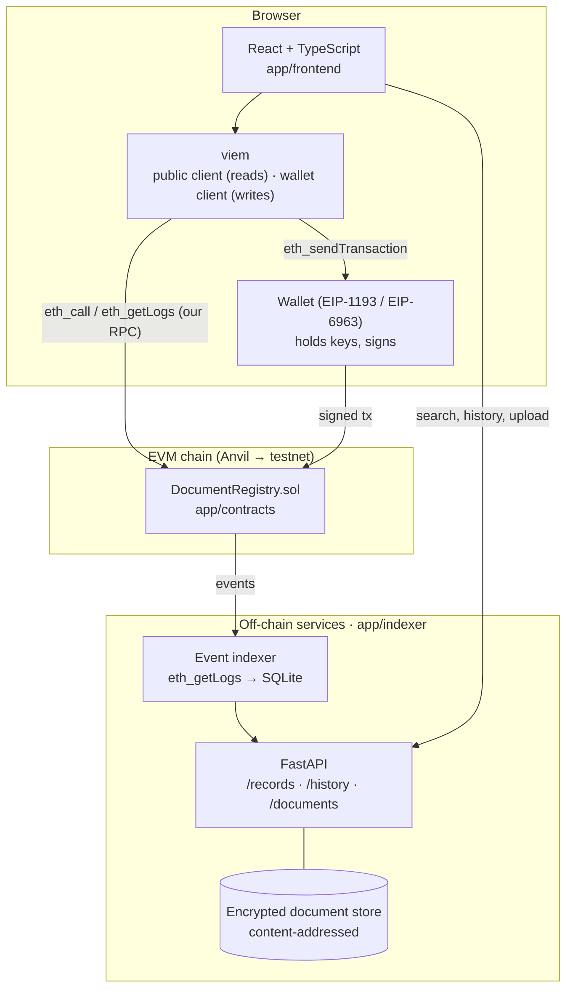

# Phase 4 — Decentralized Application Development (Weeks 10–12)

**Deliverable:** a working full-stack dApp. Users connect a wallet, register a
document (only its salted fingerprint goes on-chain), verify any document,
and search history through an off-chain indexer.

| Week | Lesson | What gets added to [`app/`](app/) |
|------|--------|---------------------------------|
| 10 | [Frontend & wallet connection](week-10-frontend-wallet/) | Contract + deploy manifest, React/viem app, wallet discovery, network guard, reads |
| 11 | [Transactions, events & errors](week-11-transactions-events/) | Salted hashing, simulate → sign → confirm flow, error decoding, live events |
| 12 | [Backend, indexing & off-chain storage](week-12-backend-indexer/) | FastAPI indexer (SQLite), encrypted document store, search + history UI |

## The architecture you're building



| Layer | Responsibility | It must NOT |
|-------|----------------|-------------|
| Frontend | UX, building txs, showing state | Hold private keys (except the clearly-flagged local dev account) |
| viem | RPC, ABI encoding, signing requests | Hide errors from the user |
| Contract | Rules and shared state that need public verification | Store documents, personal data, or anything large |
| Indexer/API | Search, history, analytics, file storage | Be the source of truth for "is this valid?" (the chain is) |

> **Not everything belongs on-chain.** Store essential verification data and
> shared state on-chain; keep large documents, sensitive information and
> heavy computation off-chain, with explicit integrity (hashes) and access
> control (encryption, auth).

## Run the whole stack

```bash
# 1. Chain
anvil

# 2. Contract (new terminal)
cd phase-4-dapp/app/contracts
forge script script/Deploy.s.sol --rpc-url http://127.0.0.1:8545 --broadcast \
  --private-key 0xac0974bec39a17e36ba4a6b4d238ff944bacb478cbed5efcae784d7bf4f2ff80

# 3. Indexer + API (Week 12)
cd ../indexer && pip install -r requirements.txt && uvicorn indexer.api:app --reload

# 4. Frontend
cd ../frontend && cp .env.example .env.local && npm ci && npm run dev   # http://localhost:5173
```
