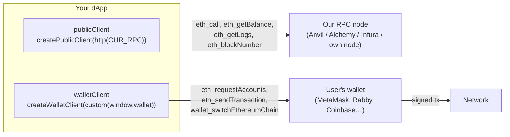
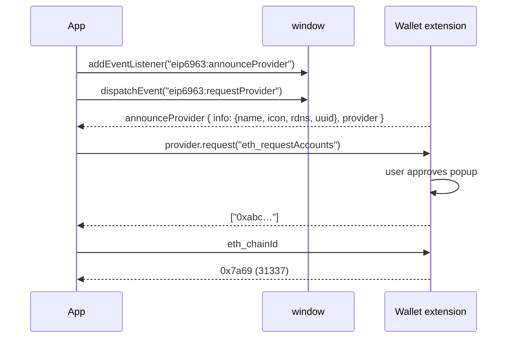
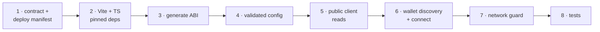

# Week 10 — TypeScript, React, Wallets & viem: Connect a Frontend to Your Contract

> **Goal:** a browser app that discovers the user's wallet, connects to it,
> guards against the wrong network, and reads live contract state over RPC.

**Code:** [`phase-4-dapp/app`](../app/) · **New tools:** Node 20+, Vite, React 18, TypeScript 5.6, viem 2.21

---

## Part A — Concepts

### 10.1 The two clients



| | Public client | Wallet client |
|---|---|---|
| Purpose | **Read** state | **Sign and send** transactions |
| Talks to | Your RPC URL | The user's wallet (EIP-1193 provider) |
| Needs the user? | No, works before connecting | Yes, and every write needs their approval |
| Costs the user gas? | Never | Writes do |

**Why read through your own RPC and not the wallet's?** Reads work before
the user connects, behave the same whichever wallet they use, and you control
rate limits and retries.

### 10.2 Wallet standards

| Standard | What it defines |
|----------|-----------------|
| **EIP-1193** | The provider API: `provider.request({ method, params })` plus events `accountsChanged`, `chainChanged` |
| **EIP-6963** | Multi-wallet discovery. Wallets *announce* themselves via window events instead of fighting over `window.ethereum` |
| **EIP-3085 / 3326** | `wallet_addEthereumChain` / `wallet_switchEthereumChain` |
| **EIP-1474 / 1193 error codes** | `4001` user rejected · `4902` unknown chain · `-32603` internal |



### 10.3 The contract ABI

The **ABI** (Application Binary Interface) is JSON that describes every
function, event and error, so a client can encode calls and decode results.
We **generate** it from Foundry's build output
([`scripts/export-abi.mjs`](../app/frontend/scripts/export-abi.mjs)) into
`src/abi/DocumentRegistry.ts` with `as const`. viem then **type-checks**
your contract calls:

```ts
client.readContract({ address, abi: documentRegistryAbi, functionName: "recordCount" }); // → Promise<bigint>
client.readContract({ ..., functionName: "recordCuont" });   // ❌ compile error: typo caught
```

> Amounts are **`bigint`** (`64n`), never `number`. JavaScript numbers lose
> precision above 2⁵³, and token amounts in wei are routinely 10¹⁸ or more.

### 10.4 Configuration and secrets in a frontend

Everything in a frontend bundle is **public**. Vite exposes only `VITE_`-prefixed
variables, and they end up in the JavaScript anyone can download.

| Goes in `VITE_*` | Never goes in the frontend |
|---|---|
| Chain ID, public RPC URL, contract address, indexer URL | Real private keys, paid API keys with write access, DB credentials |

The one exception is `VITE_DEV_PRIVATE_KEY`, a **public Anvil test key** for
local development without a browser wallet. [`parseConfig`](../app/frontend/src/config.ts)
**refuses to start** if it's set on any chain other than 31337, and that
rule has a unit test.

---

## Part B — Step-by-step build



### Step 1 — The dApp's contract and deploy manifest

[`DocumentRegistry.sol`](../app/contracts/src/DocumentRegistry.sol) is the
Week 7 design plus a `uri` pointer to off-chain storage and a one-call
`verify(hash) → (exists, active, id)`. Note what's **missing**: no
per-owner arrays. Listing someone's documents is the indexer's job.

[`Deploy.s.sol`](../app/contracts/script/Deploy.s.sol) writes
`deployments/<chainId>.json`:

```json
{ "DocumentRegistry": "0x5FbDB2315678afecb367f032d93F642f64180aa3", "chainId": 31337, "startBlock": 0 }
```

The indexer reads `startBlock` (so it doesn't scan from genesis on a real
network). Testnet manifests are committed as deployment records; local
`31337.json` is git-ignored.

### Step 2 — Project setup with pinned dependencies

[`package.json`](../app/frontend/package.json) pins **exact** versions, and
[`.npmrc`](../app/frontend/.npmrc) has `save-exact=true`. `package-lock.json`
is committed. In CI use `npm ci`, which installs exactly the lockfile.
`tsconfig.json` enables `strict` and `noUncheckedIndexedAccess`.

### Step 3 — Generate the ABI

```bash
cd app/contracts && forge build
cd ../frontend && npm run abi      # wrote 20 ABI entries to src/abi/DocumentRegistry.ts
```

### Step 4 — Validated config ([config.ts](../app/frontend/src/config.ts))

`parseConfig(env)` is a **pure function**. It validates the chain ID, URL and
address with `isAddress`, and enforces the dev-key rule. `main.tsx` renders a
clear "Configuration error" screen instead of a half-working app.

### Step 5 — Reads ([chain.ts](../app/frontend/src/lib/chain.ts), [registry.ts](../app/frontend/src/lib/registry.ts))

```ts
const publicClient = createPublicClient({ chain, transport: http(rpcUrl, { retryCount: 3, timeout: 10_000 }) });
await publicClient.getCode({ address });        // is anything deployed here?
await publicClient.readContract({ address, abi, functionName: "recordCount" });
publicClient.watchBlockNumber({ onBlockNumber, pollingInterval: 2_000 });
```

`isDeployed` gives the most common setup bug ("wrong address or wrong
chain") its own error message.

### Step 6 — Wallets ([wallet.ts](../app/frontend/src/lib/wallet.ts), [useWallet.ts](../app/frontend/src/lib/useWallet.ts))

- `discoverWallets` implements EIP-6963. `legacyInjectedProvider` falls back to `window.ethereum`.
- `connectInjected` calls `requestAddresses()` (opens the wallet popup) and reads the wallet's chain.
- `useWallet` subscribes to **`accountsChanged`** and **`chainChanged`**:
  users switch accounts and networks inside the wallet, and your UI must follow.
- Error code **4001** (user rejected) gets a calm message. It's a decision, not a crash.

### Step 7 — Network guard ([NetworkGuard.tsx](../app/frontend/src/components/NetworkGuard.tsx))

If `walletChainId !== chain.id`, show a banner with **Switch network**, which
calls `wallet_switchEthereumChain` and falls back to `wallet_addEthereumChain`
on error 4902.

### Step 8 — Tests

```bash
npm test                     # unit: config validation (7 tests)

# integration: against a real Anvil + deployed contract
INTEGRATION_RPC_URL=http://127.0.0.1:8545 \
INTEGRATION_REGISTRY=0x5FbDB2315678afecb367f032d93F642f64180aa3 npm test     # 9 tests
```

Integration tests are **skipped** when the variables are absent, so the
default `npm test` stays fast and offline. CI provides them in Week 15.

---

## Run it

```bash
anvil                                                   # terminal 1
cd phase-4-dapp/app/contracts && forge script script/Deploy.s.sol \
  --rpc-url http://127.0.0.1:8545 --broadcast \
  --private-key 0xac0974bec39a17e36ba4a6b4d238ff944bacb478cbed5efcae784d7bf4f2ff80
cd ../frontend && cp .env.example .env.local && npm ci && npm run dev
# open http://localhost:5173 → "Anvil dev account (local only)" or your wallet
```

**Using MetaMask with Anvil:** add network RPC `http://127.0.0.1:8545`,
chain ID `31337`, then import Anvil key #1 **into a separate test profile**.
After restarting Anvil, use *Settings → Advanced → Clear activity tab data*,
because the wallet caches nonces.

## Common bugs this week

| Symptom | Cause | Fix |
|---------|-------|-----|
| "No contract at 0x…" | Anvil restarted (state wiped) or wrong chain | Redeploy; check `VITE_CHAIN_ID` |
| `nonce too low` in MetaMask | Anvil restarted, wallet cached nonce | Clear activity data |
| Amount shows `1e+21` | Used `Number` for wei | Use `bigint` + `formatEther` |
| UI shows the old account | Not listening to `accountsChanged` | See `useWallet` |

## Assignment

1. Show the wallet's chain name and a block-explorer link for the account
   (use `chain.blockExplorers` for testnets).
2. Persist "last used wallet" (`rdns`) in `localStorage` and auto-reconnect
   with `eth_accounts`. That call doesn't open a popup. Why does that matter?
3. Add a unit test for `shortAddress`.

## ✅ Week 10 checklist

- [ ] Reads work **before** connecting a wallet.
- [ ] I can explain public client vs wallet client.
- [ ] The app discovers wallets via EIP-6963 and handles account/network changes.
- [ ] Wrong network is detected and switchable.
- [ ] Config is validated, and nothing secret is in `VITE_*`.
- [ ] Unit and integration tests pass.

**Next:** [Week 11 — Transactions, events & errors](../week-11-transactions-events/)
