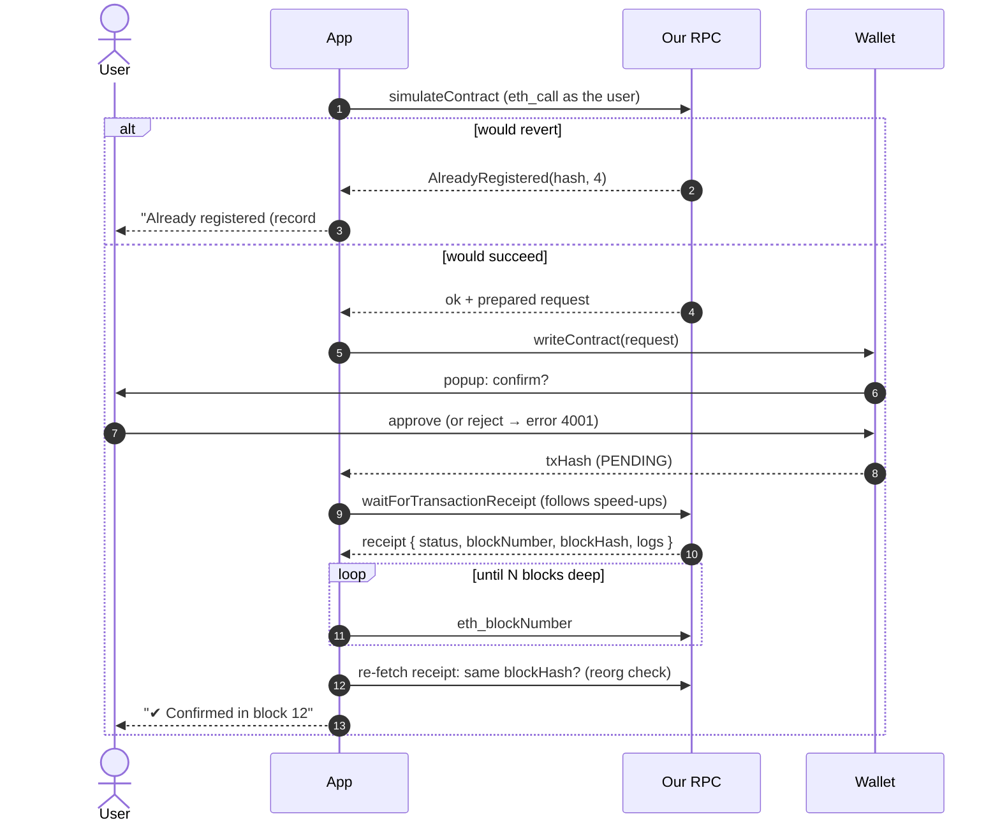
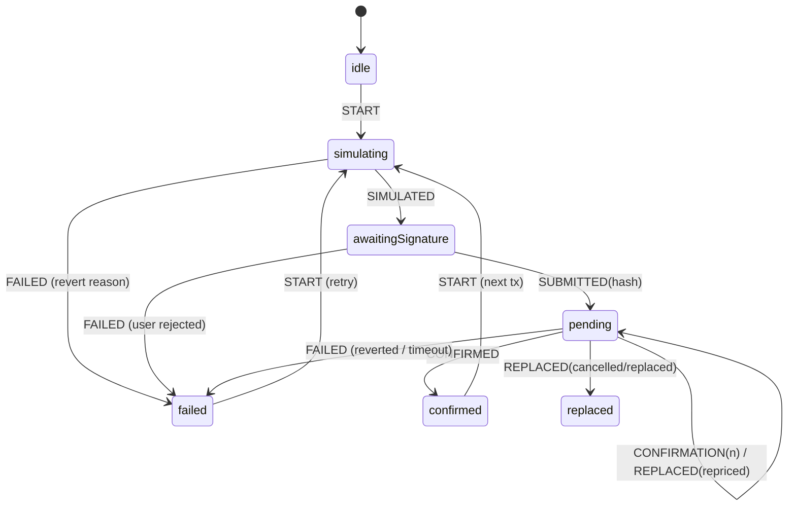
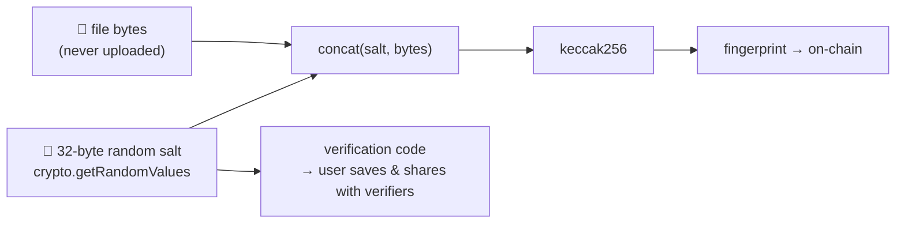

# Week 11 — Reading State, Sending Transactions, Confirmations, Events & Errors

> **Goal:** let users register, verify, retire and transfer documents
> through a transaction flow that never leaves them guessing, and that
> catches failures *before* they pay for them.

**Code:** [`phase-4-dapp/app/frontend/src`](../app/frontend/src)

---

## Part A — Concepts

### 11.1 Reading vs writing

| | Read (`eth_call`) | Write (transaction) |
|---|---|---|
| Who pays | Nobody | The sender, in gas |
| Needs a signature | No | Yes, the wallet signs |
| Changes state | No | Yes, once mined |
| Latency | One RPC round trip | Seconds to minutes (inclusion + confirmations) |
| Can fail | Throws immediately | Can fail **before** sending, **after** mining (revert), or be **replaced** |

### 11.2 The safe write flow



The flow lives in [`writes.ts`](../app/frontend/src/lib/writes.ts). Each
step has a reason:

| Step | Why it exists |
|------|---------------|
| **Simulate first** | Turns reverts into instant, free, readable errors. Integration test: a duplicate produces `["START","FAILED"]` and the **nonce doesn't change**, so no tx was sent |
| **Hash ≠ success** | A tx hash means "accepted by a node". It can still be dropped, replaced or reverted |
| **Check `receipt.status`** | A mined tx can revert (state changed between simulation and inclusion) |
| **Follow replacements** | Wallets let users *speed up* (`repriced`, same tx, new hash) or *cancel* (`cancelled`) |
| **N confirmations + reorg check** | Week 5: a block can be orphaned. On a testnet, wait 2–3 blocks; for irreversible actions use the `finalized` tag |

### 11.3 The transaction state machine



[`txState.ts`](../app/frontend/src/lib/txState.ts) is a **pure reducer**.
Illegal transitions (like `CONFIRMED` while idle) are ignored, so the UI
can't show impossible states. Because it's pure, it's unit-tested without
React or a chain. [`TxStatus.tsx`](../app/frontend/src/components/TxStatus.tsx)
renders every state, so the user always knows *what's happening* and
*what to do next*.

### 11.4 Errors users can understand

viem errors are nested (`ContractFunctionExecutionError` → `ContractFunctionRevertedError` → data).
[`describeError`](../app/frontend/src/lib/errors.ts) walks the chain:

| Raw | User sees |
|-----|-----------|
| `AlreadyRegistered(0x…, 4)` | "This exact document is already registered (record #4)." |
| `NotRecordOwner(7, 0xBob)` | "Only the owner of record #7 can do that." |
| `UserRejectedRequestError` (4001) | "You rejected the request in your wallet. Nothing was sent." |
| `InsufficientFundsError` | "Your account doesn't have enough ETH to pay for gas." |
| anything else | viem's `shortMessage` |

This is where **custom errors with arguments** (Week 7) pay off: the
frontend gets *structured data*, not a string to parse.

### 11.5 Salted fingerprints, computed in the browser



- Hashing happens **locally**. The document never leaves the device.
- The **salt** stops anyone from confirming a guessable document by hashing
  candidates. Without it, the same document registered twice would also be
  linkable.
- Verifiers need **file + verification code**. Without the code, a match
  is impossible by design. That's the privacy guarantee *and* the UX cost.
  The capstone delivers the code inside a QR link.

### 11.6 Events and logs

```ts
publicClient.watchContractEvent({ address, abi, onLogs })   // live feed (polls eth_getLogs)
parseEventLogs({ abi, logs: receipt.logs, eventName: "RecordRegistered" })   // new id from a receipt
```

- **Read the new record id from the event in the receipt**, not by calling
  `recordCount` afterwards. Someone else's tx could land in between.
- Polling can deliver a log twice. De-duplicate on **`(transactionHash, logIndex)`**.
  That's also the idempotency key the Week 12 indexer uses.
- `watchContractEvent` suits a live feed, but not history: a browser
  shouldn't scan the chain on every page load. That's the indexer's job.

---

## Part B — Step by step

| Step | File | Test |
|------|------|------|
| 1. Salted hashing | [hashing.ts](../app/frontend/src/lib/hashing.ts) | `week11.test.ts › hashing` (5) |
| 2. State machine | [txState.ts](../app/frontend/src/lib/txState.ts) | `week11.test.ts › txReducer` (6) |
| 3. Error mapping | [errors.ts](../app/frontend/src/lib/errors.ts) | `week11.test.ts › friendlyContractError` (4) |
| 4. Typed write helpers + flow | [writes.ts](../app/frontend/src/lib/writes.ts) | `writes.integration.test.ts` (3, real Anvil txs) |
| 5. Reads / verification | [reads.ts](../app/frontend/src/lib/reads.ts) | covered by integration tests |
| 6. Event decoding | [events.ts](../app/frontend/src/lib/events.ts) | `event decoding (integration)` |
| 7. React wiring | [useTx.ts](../app/frontend/src/lib/useTx.ts), [RegisterForm](../app/frontend/src/components/RegisterForm.tsx), [VerifyPanel](../app/frontend/src/components/VerifyPanel.tsx), [LiveFeed](../app/frontend/src/components/LiveFeed.tsx) | manual + typecheck |

```bash
cd phase-4-dapp/app/frontend
npm test                                    # 22 unit tests (integration skipped)
INTEGRATION_RPC_URL=http://127.0.0.1:8545 \
INTEGRATION_REGISTRY=0x5FbDB2315678afecb367f032d93F642f64180aa3 npm test    # 28 tests
npm run dev
```

**Design choice: logic in plain TS modules, React only for wiring.** Every
rule worth testing (hashing, the tx machine, error mapping, event
formatting) lives in a pure function, testable in milliseconds. Components
stay thin.

### Manual test script (do it once in the browser)

1. Connect the Anvil dev account. Register a file with label "Test 1". Watch ① → ② → ③ → ✔.
2. Copy the verification code. Verify the same file + code → **✔ Authentic and active**.
3. Register the same file again → it fails at ① with "already registered". No popup.
4. Change one byte in the file, then verify → **✘ Not registered**.
5. Retire it → verify again → **⚠ RETIRED**. The live feed shows all three events.
6. With MetaMask: reject the popup → "You rejected the request…".

## Assignment

1. Show the **gas estimate and max fee** in ETH before the user confirms
   (`estimateContractGas`, `estimateFeesPerGas`).
2. Persist pending tx hashes in `localStorage`, so a page reload resumes
   waiting instead of forgetting the transaction.
3. Make `confirmations` configurable per chain in `config.ts`, and use the
   `finalized` block tag on a testnet.

## ✅ Week 11 checklist

- [ ] Writes are simulated before the wallet prompt.
- [ ] My UI distinguishes simulating / signing / pending / confirmed / failed / replaced.
- [ ] I check `receipt.status` and wait for confirmations with a reorg check.
- [ ] Contract errors show as human sentences, using their arguments.
- [ ] The new id comes from the receipt's event, not a follow-up read.
- [ ] Logs are de-duplicated by `(txHash, logIndex)`.

**Next:** [Week 12 — Backend, event indexing & off-chain storage](../week-12-backend-indexer/)
